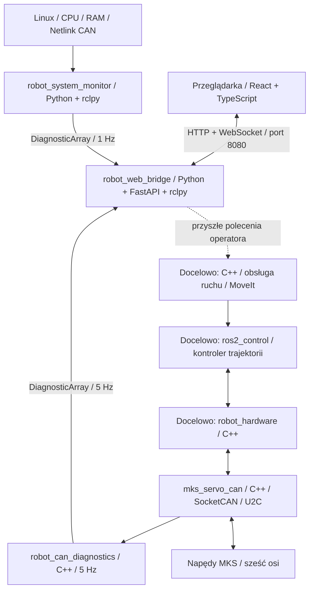

# Architektura projektu

## Platforma i stan implementacji

- System docelowy: Ubuntu 22.04, ROS 2 Humble, workspace budowany przez `colcon`.
- Sześć osi o stałych nazwach `joint_1`–`joint_6`.
- Mostek USB–CAN: BIGTREETECH U2C v2.1, docelowo udostępniony przez SocketCAN.
- Napędy: MKS SERVO42D CAN; rewizje płytek i firmware wymagają zapisania.
- C++ dla przyszłej biblioteki komunikacji i adaptera sprzętowego.
- Biblioteka `mks_servo_can` zapewnia transport SocketCAN i walidację odczytowych
  ramek protokołu MKS; `robot_can_diagnostics` jest węzłem C++ diagnostyki.
- Dwa pakiety `ament_python` dostarczają monitor systemu i backend FastAPI.
- Frontend React/TypeScript jest dostępny w fizycznej sieci LAN.

## Działająca diagnostyka i przyszłe sterowanie



Monitor i backend są osobnymi procesami. Backend ma jeden executor ROS
w osobnym wątku i współdzielony snapshot. HTTP i WebSocket odczytują pamięć;
liczba klientów nie wpływa na liczbę pomiarów ani węzłów ROS.
Panel nie udostępnia poleceń ruchu. Diagnostyka CAN wysyła tylko udokumentowane
zapytania odczytowe: identyfikację, ENABLE, stan pracy, stall i tryb pracy.

Python obsługuje diagnostykę i interfejs webowy. Przyszła pętla sterowania,
adapter sprzętowy i protokół MKS pozostają w C++. Trajektorie będą wykonywane
lokalnie, niezależnie od odświeżania strony i opóźnień sieci.
Dobór cyklu sterowania wymaga pomiarów możliwości firmware, synchronizacji
osi, opóźnień i obciążenia CAN; sama architektura nie gwarantuje płynności.

Uruchomienie, kontrakt API i zasady LAN: [panel diagnostyczny](web_status.md)
oraz [README backendu](../ros2_ws/src/robot_web_bridge/README.md).

## Docelowy przepływ danych

```text
Kontroler trajektorii (ros2_control)
                 ↕
robot_hardware: sześć osi, konwersja jednostek, cykl życia
                 ↕
mks_servo_can: protokół MKS i transport SocketCAN
                 ↕
Linux can0 ↔ USB / U2C v2.1 ↔ magistrala CAN ↔ napędy
```

`robot_description` dostarczy model i opis osi dla warstwy ROS.
`robot_bringup` będzie składał model, kontrolery i konfigurację sprzętu podczas
uruchamiania. Diagram opisuje docelową architekturę, nie istniejącą implementację.

## Odpowiedzialności pakietów

| Pakiet | Przeznaczenie | Zawartość początkowa |
| --- | --- | --- |
| `robot_description` | URDF/Xacro, geometria i ustawienia RViz | Katalogi `urdf`, `meshes`, `rviz` |
| `mks_servo_can` | Transport SocketCAN, kodowanie i dekodowanie protokołu producenta | Katalogi `include`, `src`, `test` |
| `robot_can_diagnostics` | Skan adresów, odczyty statusu i metryki CAN | Węzeł C++, usługi SCAN i Reset CAN |
| `robot_hardware` | Jeden komponent `hardware_interface::SystemInterface` dla sześciu osi | Katalogi `include`, `src`, `test` |
| `robot_bringup` | Pliki launch i konfiguracja całego robota | Katalog `launch`, trzy szablony YAML |
| `robot_system_monitor` | CPU, RAM, stan CAN i kontrolerów | Węzeł `monitor`, testy |
| `robot_web_bridge` | API tylko do odczytu i pliki panelu | Węzeł `bridge`, HTTP/WebSocket, testy |

Biblioteka `mks_servo_can` powinna oddzielać transport od kodowania wiadomości,
aby przyszłe testy protokołu nie wymagały napędów. Adapter `robot_hardware`
będzie odpowiadał za mapowanie osi, przekładnie, znaki, offsety oraz konwersję
jednostek między ROS i napędami.

Manifesty pakietów sprzętowych deklarują tylko używany system budowania `ament_cmake`.
Zależności od `hardware_interface`, `pluginlib`, `rclcpp`, biblioteki CAN,
kontrolerów i narzędzi wizualizacji należy dodać wraz z korzystającym z nich
kodem. Nie ma jeszcze bibliotek ani pluginów sprzętowych. Diagnostyka używa
tematów `/robot/system_status` i `/robot/can/diagnostics`; skaner nie mapuje
wykrytych adresów na osie `joint_1`–`joint_6`.

Przyszły adapter należy oprzeć na API Humble, opisanym w
[instrukcji tworzenia komponentu sprzętowego ros2_control](https://control.ros.org/humble/doc/ros2_control/hardware_interface/doc/writing_new_hardware_component.html).
Eksport pluginu będzie dodany dopiero razem z rzeczywistą biblioteką.

## Konwencje i dane do ustalenia

- Oś `joint_1` oznacza pierwszą oś łańcucha od podstawy, a `joint_6` ostatnią
  przed narzędziem. Tych nazw należy używać w modelu, adapterze i kontrolerze.
- Jednostki po stronie ROS: radiany, rad/s i rad/s²; długości modelu w metrach.
- Wymiary, osie obrotu, układy współrzędnych, masy i bezwładności wymagają danych
  mechanicznych. Szkielet nie dostarcza zastępczej geometrii.
- Dla każdego przegubu należy ustalić CAN ID, firmware, przełożenie, kierunek,
  offset zera, limity pozycji, prędkości i przyspieszenia oraz metodę bazowania.
- Przed implementacją trzeba określić częstotliwość cyklu sterowania, sposób
  odczytu pozycji i obsługę timeoutów oraz błędów napędów.
- Wzór konwersji i znaczenie pól przełożenia opisuje README `robot_bringup`.

Pliki CAD należy umieszczać w `hardware/cad`, schematy w `hardware/wiring`,
a dokumentację odpowiadającą posiadanym wersjom urządzeń w `hardware/datasheets`.
Model wynikowy dla ROS będzie należał do `robot_description`.
