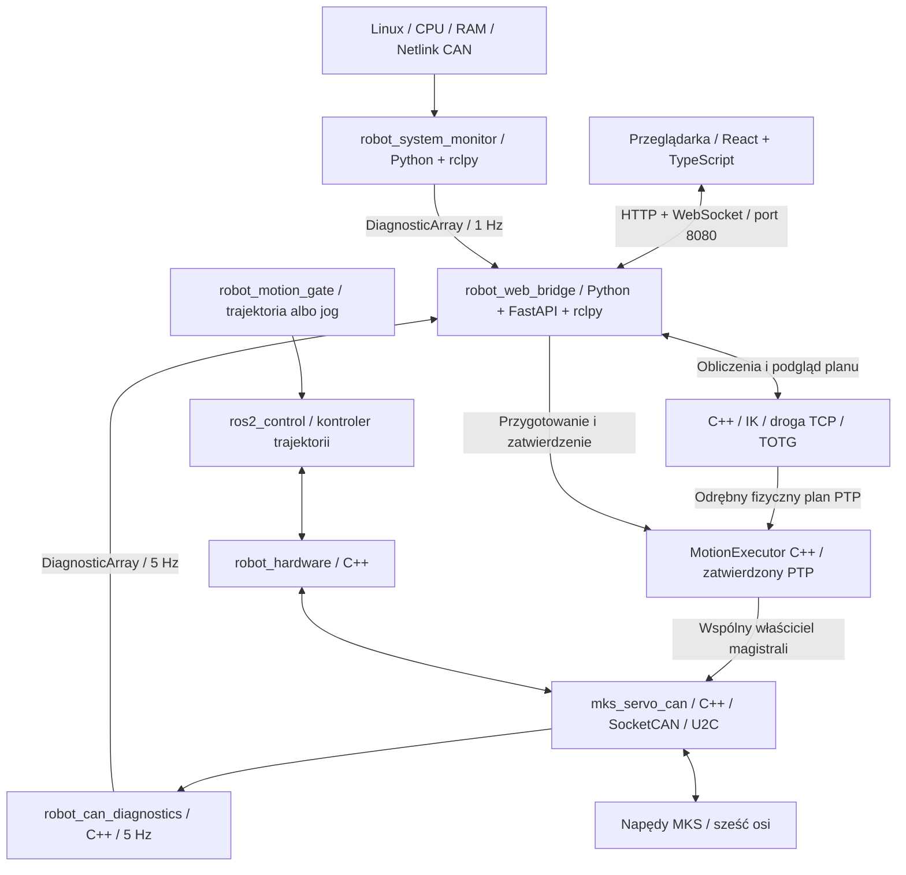

# Architektura projektu

## Platforma i stan implementacji

- System docelowy: Ubuntu 22.04, ROS 2 Humble, workspace budowany przez `colcon`.
- Sześć osi o stałych nazwach `joint_1`–`joint_6`.
- Mostek USB–CAN: BIGTREETECH U2C v2.1, docelowo udostępniony przez SocketCAN.
- Napędy: MKS SERVO42D CAN; rewizje płytek i firmware wymagają zapisania.
- C++ dla wspólnego managera CAN i pluginu `robot_hardware/CanSystem`.
- Biblioteka `mks_servo_can` zapewnia transport SocketCAN i walidację odczytowych
  ramek protokołu MKS; `robot_can_diagnostics` jest węzłem C++ diagnostyki.
- Dwa pakiety `ament_python` dostarczają monitor systemu i backend FastAPI.
- Frontend React/TypeScript jest dostępny w fizycznej sieci LAN.
- `robot_kinematics` (KDL/Eigen) i `robot_motion_planner` (TOTG) obliczają
  [IK i drogę TCP](cartesian_planning.md), bez otwierania CAN i wykonywania planu.

## Diagnostyka i sterowanie

Harmonogram, arbitraż źródeł, interfejsy i warunki aktywacji opisuje
[strategia CAN](can_strategy.md). Model i konfiguracja MoveIt wymagają danych robota.
Panel ręczny zawiera [podgląd URDF 3D](robot_preview.md): przykładowy model
ROS w `/robot/preview` i ten sam strumień pozycji. Osie skonfigurowane uwzględniają
przekładnie, kierunki i offsety; pozostałe mają demonstracyjne odwzorowanie 1:1.
Węzeł `robot_configuration` zarządza snapshotami JSON i transakcją zastosowania;
podgląd szkicu nie zmienia ROS przed zatwierdzeniem. Opis: [konfiguracja](configuration.md).
Ta geometria służy wyłącznie wizualizacji, bez dodatkowych odczytów CAN.



Monitor i backend są osobnymi procesami. Backend ma jeden executor ROS
w osobnym wątku i współdzielony snapshot. HTTP i WebSocket odczytują pamięć;
liczba klientów nie wpływa na liczbę pomiarów ani węzłów ROS.
Obliczanie planu nie wykonuje ruchu; ręczne ENABLE/zero/JOG mają oddzielne API.
Odczytowa diagnostyka CAN wysyła udokumentowane
zapytania odczytowe: identyfikację, ENABLE, stan pracy, stall i tryb pracy.

Python obsługuje monitor systemu, interfejs webowy i arbitraż źródeł. Adapter
sprzętowy i wspólny manager MKS działają w C++. Trajektorie są wykonywane
lokalnie, niezależnie od odświeżania strony i opóźnień sieci.
Dobór cyklu sterowania wymaga pomiarów możliwości firmware, synchronizacji
osi, opóźnień i obciążenia CAN; sama architektura nie gwarantuje płynności.

Uruchomienie, kontrakt API i zasady LAN: [panel diagnostyczny](web_status.md)
oraz [README backendu](../ros2_ws/src/robot_web_bridge/README.md).

## Pętla 100 Hz i asynchroniczny odbiór — 25.10.2026

Kontroler publikuje q/v co 10 ms. CanSystem eksportuje position i velocity w obu
kierunkach. write przekazuje najnowszą próbkę atomową skrzynką do jednego
CanBusManager; lokalny MotionExecutor ma wcześniej skompilowaną trajektorię.
Wspólna funkcja streaming_setpoint wylicza q+v*0,085 s, FF1 i korekcję
Kp2,5 ze świeżej pozycji; osobny residual każdej osi realizuje dithering RPM.
Uwzględnia limity,
przekładnię, kierunek i offset. F5 jest wysyłane bez oczekiwania na ACK,
przy CanRSP=Disable i 4A=0; potem planowane są 31 nominalnie 100 Hz/oś.

SocketCAN ma oddzielny wątek RX: O_NONBLOCK, poll 1 ms, atomowy cache int64/czas
oraz kolejkę SPSC 4096 ramek (pojemność użytkowa 4095). Przepełnienie/utrata
transportu jest sygnalizowana managerowi. read/write nie wykonują recv ani nie
czekają na mutex managera. read przelicza impulsy na radiany, prędkość z różnicy
pozycji i rzeczywistych znaczników pomiarów. Aktywacja inicjuje zadane pozycje
odczytami sprzętu, a prędkości zerem.

W strumieniu brak pauz tolerancji pośredniej. Ostatni cel ma dwie kontrole
końcowej pozycji >=100 ms od siebie. STOP i jawne awarie pozostają aktywne.
Wymagany dla sześciu osi profil 1 Mbit/s mieści robot w 26,58% magistrali;
przyszły moduł zachowuje 20 punktów rezerwy. Fizyczny 500k nie jest automatycznie
przełączany. Dla CAN wymagany SR_vFOC, nie impulsowy CR_vFOC.
[Kontrakt i konfiguracja](motion_execution.md), [formaty ramek](can_protocol.md).
Wspólny zegar nie zapewnia sprzętowo równoczesnego startu ani twardego RT.

## Docelowy przepływ danych

```text
Kontroler trajektorii (ros2_control)
                 ↕
robot_hardware: sześć osi, konwersja jednostek, cykl życia
                 ↕
mks_servo_can: protokół MKS i transport SocketCAN
                 ↕
Linux can0 ↔ USB / U2C v2.1 ↔ magistrala CAN ↔ napędy
```

`robot_description` dostarczy model i opis osi dla warstwy ROS.
`robot_bringup` będzie składał model, kontrolery i konfigurację sprzętu podczas
uruchamiania. Ruch nie jest jeszcze odebrany na fizycznym robocie.

## Odpowiedzialności pakietów

| Pakiet | Przeznaczenie | Zawartość początkowa |
| --- | --- | --- |
| `robot_description` | URDF/Xacro, geometria i ustawienia RViz | Katalogi `urdf`, `meshes`, `rviz` |
| `mks_servo_can` | Transport SocketCAN, kodowanie i dekodowanie protokołu producenta | Katalogi `include`, `src`, `test` |
| `robot_can_diagnostics` | Skan adresów, odczyty statusu i metryki CAN | Węzeł C++, usługi SCAN i Reset CAN |
| `robot_hardware` | Jeden komponent `hardware_interface::SystemInterface` dla sześciu osi | Katalogi `include`, `src`, `test` |
| `robot_bringup` | Pliki launch i konfiguracja całego robota | Katalog `launch`, trzy szablony YAML |
| `robot_system_monitor` | CPU, RAM, stan CAN i kontrolerów | Węzeł `monitor`, testy |
| `robot_web_bridge` | API tylko do odczytu i pliki panelu | Węzeł `bridge`, HTTP/WebSocket, testy |

Biblioteka `mks_servo_can` oddziela transport od kodowania wiadomości,
dzięki czemu testy nie wymagają napędów. Adapter `robot_hardware`
odpowiada za mapowanie osi, przekładnie, znaki, offsety oraz konwersję
jednostek między ROS i napędami.

Manifesty deklarują zależności używane przez biblioteki i plugin. Diagnostyka używa
tematów `/robot/system_status` i `/robot/can/diagnostics`; skaner nie mapuje
wykrytych adresów na osie `joint_1`–`joint_6`.

Adapter korzysta z API Humble, opisanego w
[instrukcji tworzenia komponentu sprzętowego ros2_control](https://control.ros.org/humble/doc/ros2_control/hardware_interface/doc/writing_new_hardware_component.html).
Eksport pluginu i test jego ładowania znajdują się w `robot_hardware`.

## Konwencje i dane do ustalenia

- Oś `joint_1` oznacza pierwszą oś łańcucha od podstawy, a `joint_6` ostatnią
  przed narzędziem. Tych nazw należy używać w modelu, adapterze i kontrolerze.
- Jednostki po stronie ROS: radiany, rad/s i rad/s²; długości modelu w metrach.
- Wymiary, osie obrotu, układy współrzędnych, masy i bezwładności wymagają danych
  mechanicznych. Przykładowy URDF jest oddzielony od rzeczywistej konfiguracji.
- CAN ID 1–6 odpowiadają J1–J6. Dla każdego przegubu trzeba potwierdzić firmware, przełożenie, kierunek,
  offset zera, limity pozycji, prędkości i przyspieszenia oraz metodę bazowania.
- Przed implementacją trzeba określić częstotliwość cyklu sterowania, sposób
  odczytu pozycji i obsługę timeoutów oraz błędów napędów.
- Wzór konwersji i znaczenie pól przełożenia opisuje README `robot_bringup`.

Pliki CAD należy umieszczać w `hardware/cad`, schematy w `hardware/wiring`,
a dokumentację odpowiadającą posiadanym wersjom urządzeń w `hardware/datasheets`.
Model wynikowy dla ROS będzie należał do `robot_description`.
# Ręczne sterowanie wałami

CAN 1–6 odpowiadają osiom J1–J6. Panel desktop udostępnia osobny
`ManualMotorController` (C++): ENABLE, zero bieżącego położenia oraz JOG prędkościowy.
Backend przekazuje żądania przez typowane interfejsy ROS; moduł używa wspólnego
managera i jednego transportu CAN. Bez modelu robota, pojedynczo, w jednostkach
wału silnika. Szczegóły: [sterowanie ręczne](manual_control.md).

Fizyczny PTP, wyłączność programu, niepełny zestaw napędów i odbiór: [motion_execution.md](motion_execution.md).
