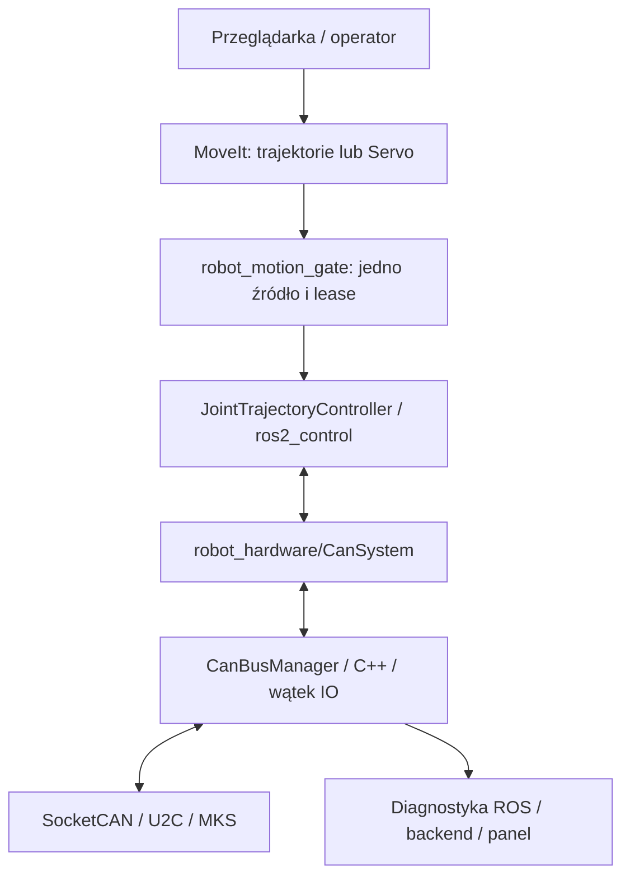

# Sterowanie i diagnostyka przez wspólny manager CAN

Ręczne ENABLE, zero i prędkościowy JOG pojedynczego wału opisuje
[moduł ręczny](manual_control.md). Działa bez modelu robota, przy tym samym
właścicielu CAN, i wyklucza się ze sterowaniem sześciu osi opisanym poniżej.

## Przepływ i właściciel magistrali



`CanBusManager` jest jedynym modułem planującym ramki. W trybie diagnostycznym
działa w `robot_can_diagnostics`. Podczas sterowania ten sam kod i publikator
diagnostyki działają w pluginie `robot_hardware/CanSystem`; osobny właściciel
magistrali nie jest uruchamiany. Panel należy wtedy uruchamiać przez
`web_status.launch.py standalone_can:=false configuration_enabled:=false preview_enabled:=false`
(konfiguracja i podgląd są wtedy uruchomione przez launch sterowania).

Blokada procesu dla pary użytkownik/interfejs w `/tmp` zapobiega uruchomieniu
dwóch właścicieli z projektu przez to samo konto. Nie blokuje obcych programów
SocketCAN ani innych kont. Magistrala musi mieć jednego nadawcę poleceń ruchu.

## Harmonogram i budżet

| Operacja | Profil startowy | Zasada |
| --- | --- | --- |
| Stop i błędy | Przy wykryciu | Przerwanie pracy, zatrzask błędu |
| Zestaw pozycji sześciu osi | 50 Hz | Najnowsza próbka, bez historii poleceń |
| Pozycje rzeczywiste `0x31` | 25 Hz / oś | Dwie naprzemienne grupy, osobna świeżość |
| ENABLE i stall | 10 Hz | Osobne znaczniki czasu |
| Prędkość / stan pracy | 20 Hz w PTP i dla przygotowanych osi; stan 2 Hz poza nimi | Terminy rozłożone, ustępują komendom |
| Tryb pracy | Przy wykryciu / co 5 s w postoju | W ruchu bez zmian konfiguracji |
| Publikacja do panelu | 5 Hz | Korzysta z cache |
| SCAN, reset | Bez aktywnego sterowania | Brak automatycznego wznowienia |

Zwykłe transakcje mają cztery sloty i najwyżej jedno zapytanie na adres.
Koszt rezerwujemy wspólnie dla żądania i odpowiedzi: konserwatywnie
`55 + 10 * DLC` bitów na standardową ramkę wraz ze stuffingiem i odstępem.
Cel planowania to najwyżej 40% przy 500000 bit/s; limit konfiguracji pozostaje
najwyżej 50%, STOP omija budżet. Obciążenie planowane nie jest fizycznym
pomiarem magistrali i nie obejmuje retransmisji.

W strumieniowanym PTP wspólny okres planera, kompilatora i IO wynosi 20 ms:

| Faza cyklu | Praca |
| --- | --- |
| 0–8 ms | F5 kolejnego zestawu i komplet ACK |
| 8–14 ms | Enkodery jednej z dwóch grup |
| 14–18 ms | Diagnostyka; najwyżej osiem transakcji |
| 18–20 ms | Rezerwa, bez nowych zapytań |
| Granica cyklu | SYNC, wyłącznie po komplecie ACK |

Ostatnie 2 ms okna odczytu są zarezerwowane dla odpowiedzi; nowego zapytania
nie rozpoczynamy w tej końcówce. Timeout odpowiedzi jest ograniczony końcem
okna. Przed wejściem w harmonogram odświeżamy wszystkie pozycje i opróżniamy
zwykłe sloty; pierwszy zestaw jest przygotowany przed pierwszym SYNC.
Uczestnicy są rozdzielani naprzemiennie według kolejności CAN ID,
również dla niepełnego zestawu. W ruchu pozostałe adresy nie zajmują budżetu.

Dla sześciu osi F5 + ACK + dodatkowe raporty + SYNC zajmują 1905 bitów/cykl,
trzy odczyty enkoderów 630 bitów/cykl. ENABLE/stall 10 Hz i prędkość/stan
20 Hz dodają średnio 1176 bitów/cykl. Łącznie to 3711 bitów, **37,11%**;
górna granica ośmiu odczytów diagnostycznych to 3895 bitów, **38,95%**.
Rezerwacja diagnostyki nie może zużyć kredytów komend ani pozycji.
Terminy diagnostyki przesuwamy o okres, unikając dryfu zależnego od pobudek IO.
Profil 10 ms jest odrzucany; program nie zmienia bitrate ani nie pomija próbek.

Odpowiedzi dopasowuje się do adresu, komendy, DLC, sumy i terminu. Błędna ramka
nie usuwa oczekującego zapytania. Po timeoutcie obowiązuje dodatkowa kwarantanna
adresu. MKS nie ma numeru transakcji: nie da się niezawodnie odróżnić dowolnie
spóźnionej identycznej odpowiedzi od nowej. Dopuszczalną latencję trzeba zmierzyć;
wykryta utrata terminów powoduje błąd sterowania.

## Wykonanie i zatrzymanie

JTC lokalnie interpoluje trajektorię. W IO używamy listy wykrytych adresów
i przygotowanych zapytań; walidacja CRC nie kopiuje payloadu do nowego wektora.
`read()` i `write()` adaptera używają prób
blokady (`try_lock`), tablic sześciu osi i ostatnich wartości; nie wywołują CAN
i nie czekają na odpowiedzi. Wątek IO jest niezależny od executorów ROS.
Nie stanowi to potwierdzenia twardych gwarancji czasu rzeczywistego.

Każdy zestaw ma numer, źródło, czas utworzenia i termin ważności. Po sprawdzeniu
limitów pozycji, prędkości i przyspieszenia manager wysyła sześć F5. Dopiero komplet
odpowiedzi `F5 05 CRC` pozwala wysłać broadcast `4B 4B`. Brak ACK lub przeterminowana
próbka blokują SYNC i wywołują stop. SYNC nie ma potwierdzenia odbioru; zgodność
ruchu trzeba nadzorować pozycjami.

Próbka z `CanSystem` może zawierać pozycje i prędkości JTC. Wspólny kompilator
F5 wyznacza RPM z profilu próbki zamiast zawsze używać maksimum osi; kod `acc`
pozostaje osobnym parametrem napędu. Podgląd przyszłych zestawów 50 Hz oblicza
[planner kartezjański](cartesian_planning.md), który nie wysyła niczego do CAN.
Lokalny wykonawca PTP przygotowuje zestawy przed planowanym SYNC i nadzoruje
śledzenie względem czasu pomiaru. Zgodność ramek nie gwarantuje wspólnego czasu
dojazdu; wymagany odbiór sprzętowy opisuje [wykonanie PTP](motion_execution.md).

Startowe progi oprogramowania: 60 ms dla pozycji i nowych zapisów kontrolera,
300 ms dla ENABLE/stall, 200 ms dla lease źródła. Nie wyznaczają one dopuszczalnej
drogi zatrzymania robota i wymagają odbioru na sprzęcie.

Przy fault aktywnego sterowania manager zatrzaskuje błąd i blokuje SYNC.
Wysyła F7 do wszystkich skonfigurowanych osi, następnie F6 RPM=0 do tych samych
osi (dla PTP CAN 1–6). Po ACK F7 obecnych napędów lub timeoutcie rozpoczyna
F6; cała procedura ma najwyżej dwa timeouty, domyślnie 40 ms. Osobne maski
ACK, odrzucenia i braków są publikowane w diagnostyce. Potem kończy wszelkie
nadawanie, aby nie podtrzymywać firmware watchdog. Zamknięcie transportu
wykonuje pozostałą próbę F6 bez czekania i raportuje niepotwierdzone odpowiedzi.
Nie wysyła SYNC ani nie załącza ENABLE. ACK F7/F6 nie jest dowodem skasowania
przygotowanego celu i nie ustawia flag odbioru. Ta polityka wymaga wcześniejszej
weryfikacji z obciążeniem i hamulcami (`stop_verified`). Sprzętowy obwód awaryjny
pozostaje niezależny. Reset lub rekonfiguracja kasują zatrzask, lecz nie aktywują
ruchu. Program nie ustawia automatycznie trybu, ENABLE, synchronizacji ani watchdog.

## Interfejs ruchu i konfiguracja

`motion_gate.py` udostępnia:

- `/robot/motion/follow_joint_trajectory`: proxy akcji `FollowJointTrajectory`,
  z feedbackiem, wynikiem i anulowaniem; jeden aktywny cel.
- `/robot/motion/jog_trajectory`: kompletne `JointTrajectory` z Servo,
  ze świeżym nagłówkiem i horyzontem najwyżej 200 ms.
- `/robot/motion/select_trajectory`, `/robot/motion/select_jog`,
  `/robot/motion/select_none`: `Trigger`. Wybór źródła przed aktywacją hardware.
- `/robot/motion/lease`: wewnętrzny `UInt64MultiArray` co 20 ms:
  `[źródło, monotonic_ns]`, gdzie 0 = brak, 1 = trajektoria, 2 = jog. Procesy
  działają na tym samym Linuxie. Opóźnione wiadomości nie odnawiają lease.
  Zanik gate zatrzymuje ruch niezależnie od zapisów JTC.
- `/robot/motion/stop`: `Trigger` publikatora diagnostyki, zatrzymanie z zatrzaskiem.

MoveIt wysyła akcje do proxy, Servo kieruje wyjściowy topic do jog. Nie wysyła się
równolegle komend bezpośrednio do JTC. ROS localhost ogranicza zasięg sieciowy,
ale nie autoryzuje lokalnych procesów. Jog po 200 ms bez wiadomości wycofuje lease.
Aktywna trajektoria bez feedbacku kontrolera przez 500 ms też wycofuje lease.
Poprawnie zakończona trajektoria utrzymuje ostatnią pozycję.

`robot_bringup/config/ros2_control.example.xacro` jest fragmentem rzeczywistego
URDF, bez geometrii. Wymaga pełnego YAML sześciu osi: adresów, przełożeń, kierunków,
offsetów, limitów, dopuszczalnego błędu śledzenia i kodu przyspieszenia MKS.
Kod MKS nie jest przyspieszeniem w rad/s². `null`, duplikaty i wartości nieskończone
są odrzucane. Adresy 1, 2 i 4 nie są automatycznie przypisywane do przegubów.

Po uzupełnieniu modelu i odbiorze sprzętu:

```bash
ros2 launch robot_bringup motion_control.launch.py \
  robot_description_file:=/ścieżka/do/pełnego.urdf \
  controllers_file:=/ścieżka/do/uzupełnionych_kontrolerów.yaml
./scripts/start_web_status.sh standalone_can:=false configuration_enabled:=false preview_enabled:=false
```

Launch pozostawia hardware i kontroler trajektorii nieaktywne. Po skanie,
wyborze źródła i potwierdzeniu gotowości wymagana jest jawna aktywacja. Cztery
flagi `motion_enabled`, `commissioning_verified`, `synchronization_verified`,
`stop_verified` muszą być świadomie ustawione po odbiorze SR_CLOSE/SR_vFOC,
bazowania, ENABLE, synchronizacji, ACK, hamulców i watchdog. Bieżące CR_vFOC
nie spełnia warunków. Model i konfiguracja MoveIt/Servo nie są wymyślane.

## Testy i odbiór

Emulator sześciu napędów i wstrzykiwany zegar sprawdzają pełny skan, echo, błędne
i spóźnione odpowiedzi, ACK/SYNC, utratę pozycji, komend, lease, BUS-OFF oraz USB.
Minuta symulowanego ruchu 50 Hz sprawdza budżet i wzrost RSS po rozgrzaniu.
To nie jest test płynności fizycznego robota ani minuta czasu ściennego.

Przed ruchem trzeba zmierzyć sześć osi: terminy ACK, rozrzut aktualizacji,
błąd śledzenia i fizyczne obciążenie/retransmisje. RTT jest mierzone zegarem
monotonicznym przy odczycie socketu w userspace; obejmuje USB i pobudkę IO
(docelowo 1 ms), nie jest czasem samego przewodu. Odbiór musi potwierdzić F7,
synchronizację i watchdog. Jeśli terminy nie są dotrzymane, cykl wykonawczy
należy przenieść do odpowiedniego lokalnego kontrolera.

## Fizyczny PTP i niepełny zestaw napędów

Fizyczny PTP ma odrębne przygotowanie, lokalny wykonawca C++ i jawne zatwierdzenie.
Ustawienie `allow_missing_motion` dopuszcza pominięcie nieobecnych napędów;
nie potwierdza osiągnięcia TCP i nie zmienia ograniczeń osi uczestniczących.
Obowiązujące zasady wykonania i odbioru: [motion_execution.md](motion_execution.md).
Wcześniejsze opisy podglądu PTP/LIN nadal dotyczą symulacji; fizyczny LIN pozostaje zablokowany.
