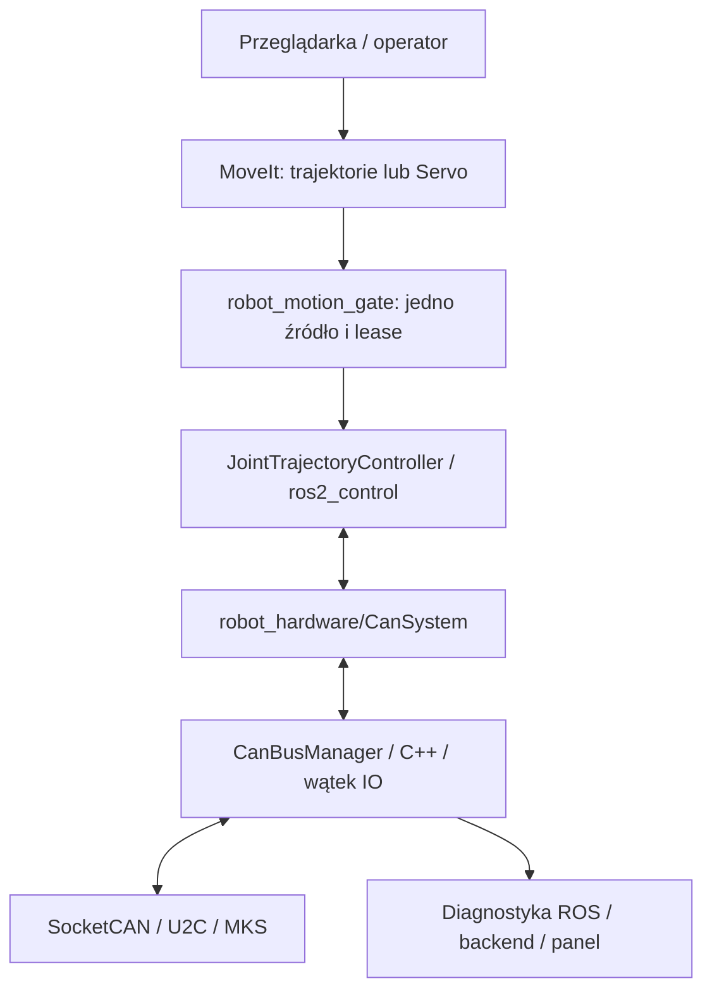

# Sterowanie i diagnostyka przez wspólny manager CAN

Ręczne ENABLE, zero i prędkościowy JOG pojedynczego wału opisuje
[moduł ręczny](manual_control.md). Działa bez modelu robota, przy tym samym
właścicielu CAN, i wyklucza się ze sterowaniem sześciu osi opisanym poniżej.

## Przepływ i właściciel magistrali



`CanBusManager` jest jedynym modułem planującym ramki. W trybie diagnostycznym
działa w `robot_can_diagnostics`. Podczas sterowania ten sam kod i publikator
diagnostyki działają w pluginie `robot_hardware/CanSystem`; osobny właściciel
magistrali nie jest uruchamiany. Panel należy wtedy uruchamiać przez
`web_status.launch.py standalone_can:=false configuration_enabled:=false preview_enabled:=false`
(konfiguracja i podgląd są wtedy uruchomione przez launch sterowania).

Blokada procesu dla pary użytkownik/interfejs w `/tmp` zapobiega uruchomieniu
dwóch właścicieli z projektu przez to samo konto. Nie blokuje obcych programów
SocketCAN ani innych kont. Magistrala musi mieć jednego nadawcę poleceń ruchu.

## Harmonogram i budżet — 100 Hz

| Operacja | Okres | Zasada |
| --- | --- | --- |
| F5 uczestników |10 ms | aktualna faza q/v, lookahead85 ms, FF1, Kp2,5 i dithering RPM, bez ACK/SYNC |
|31 w PTP/JTC |10 ms/oś | asynchroniczne zapytania, osobny RX/cache |
|31 poza sterowaniem |40 ms/oś | dotychczasowa diagnostyka/JOG |
| ENABLE/stall |100 ms | osobne znaczniki, jawny błąd przerywa |
| prędkość/F1 |50 ms w ruchu | bez pauz pośredniej tolerancji |
| publikacja panelu |200 ms | z cache, liczba klientów nie zwiększa CAN |
| konfiguracja/skan |w postoju | zwykłe odpowiedzi, maksymalnie 4 oczekujące |

F5 nie zajmuje miejsca oczekiwania i nie czeka na odczyt 31. Wspólne F5 ma
pierwszeństwo przed diagnostyką; koszt całego zestawu jest rezerwowany przed
nadaniem. Zwykłe odpowiedzi mają walidację adresu/komendy/DLC/sumy/terminu.
Przy spóźnieniu zegara jedna aktualna klatka zastępuje nieaktualne, bez serii
nadrabiania. Brak budżetu daje waiting_budget, nie częściowy zestaw.

Konserwatywny koszt ramki:55+10*DLC bitów. Przy 100 Hz F5+31 i dotychczasowej
diagnostyce 4/6 osi kosztują 35,44/53,16% przy 500k albo 17,72/26,58% przy 1M.
Robot ma 40%, przyszły moduł osobne 20 punktów, łącznie 60%. Profil 6 osi 500k
jest odrzucany; maksymalny konfiguracyjny limit 50% nie rozszerza puli robota.
Nie obejmuje to retransmisji ani arbitralnego przyszłego modułu bez jego profilu.

## Wykonanie i zatrzymanie

CanSystem read/write korzystają z atomowych skrzynek najnowszej próbki i cache;
nie oczekują na mutex ani odbiór. IO jest jedynym nadawcą, a osobny RX używa
O_NONBLOCK+poll 1 ms. Komendy obejmują position i velocity; hardware udostępnia
oba stany. Aktywacja inicjuje cele rzeczywistymi odczytami, prędkości 0.

F5/F6/FE są bez ACK. Uzbrojenie PTP ustawia i odczytuje `8C 00/00` i `4A 0`, sprawdza
SR_vFOC, watchdog 300 ms, mikrokroki, F1 i start. Nie ma SYNC ani pauz tolerancji
pośredniej. Jedynie ostatni cel czeka na dwie kontrole pozycji >=100 ms od siebie;
waiting_position/waiting_feedback nie ponawiają ruchu. Po sukcesie nie uruchamiają
się stare nastawy JTC. Brak pośredniej pozycji PTP nie przerywa strumienia.

JTC zachowuje watchdog komend/pozycji 60 ms oraz lease 200 ms; ręczny JOG ma własne
reguły. Nie ma przerwania JTC od samej różnicy q pomiar/zadanie. Jawne błędy
napędu, operator STOP, BUS-OFF i utrata transportu zatrzaskują fault.
STOP natychmiast nadaje F7 wszystkich osi, potem F6(0), bez czekania na ACK,
następnie cisza. Wysłanie STOP nie potwierdza skutecznego postoju ani hamowania.
Reset nie aktywuje ruchu. Szczegóły: [kontrakt PTP](motion_execution.md).

## Interfejs ruchu i konfiguracja

`motion_gate.py` udostępnia:

- `/robot/motion/follow_joint_trajectory`: proxy akcji `FollowJointTrajectory`,
  z feedbackiem, wynikiem i anulowaniem; jeden aktywny cel.
- `/robot/motion/jog_trajectory`: kompletne `JointTrajectory` z Servo,
  ze świeżym nagłówkiem i horyzontem najwyżej 200 ms.
- `/robot/motion/select_trajectory`, `/robot/motion/select_jog`,
  `/robot/motion/select_none`: `Trigger`. Wybór źródła przed aktywacją hardware.
- `/robot/motion/lease`: wewnętrzny `UInt64MultiArray` co 20 ms:
  `[źródło, monotonic_ns]`, gdzie 0 = brak, 1 = trajektoria, 2 = jog. Procesy
  działają na tym samym Linuxie. Opóźnione wiadomości nie odnawiają lease.
  Zanik gate zatrzymuje ruch niezależnie od zapisów JTC.
- `/robot/motion/stop`: `Trigger` publikatora diagnostyki, zatrzymanie z zatrzaskiem.

MoveIt wysyła akcje do proxy, Servo kieruje wyjściowy topic do jog. Nie wysyła się
równolegle komend bezpośrednio do JTC. ROS localhost ogranicza zasięg sieciowy,
ale nie autoryzuje lokalnych procesów. Jog po 200 ms bez wiadomości wycofuje lease.
Aktywna trajektoria bez feedbacku kontrolera przez 500 ms też wycofuje lease.
Poprawnie zakończona trajektoria utrzymuje ostatnią pozycję.

`robot_bringup/config/ros2_control.example.xacro` jest fragmentem rzeczywistego
URDF, bez geometrii. Wymaga pełnego YAML sześciu osi: adresów, przełożeń, kierunków,
offsetów, limitów i parametrów strumienia (CPR, acc, lookahead, FF, RPM).
Kod MKS nie jest przyspieszeniem w rad/s². `null`, duplikaty i wartości nieskończone
są odrzucane. Adresy 1, 2 i 4 nie są automatycznie przypisywane do przegubów.

Po uzupełnieniu modelu i odbiorze sprzętu:

```bash
ros2 launch robot_bringup motion_control.launch.py \
  robot_description_file:=/ścieżka/do/pełnego.urdf \
  controllers_file:=/ścieżka/do/uzupełnionych_kontrolerów.yaml
./scripts/start_web_status.sh standalone_can:=false configuration_enabled:=false preview_enabled:=false
```

Launch pozostawia hardware i kontroler trajektorii nieaktywne. Po skanie,
wyborze źródła i potwierdzeniu gotowości wymagana jest jawna aktywacja. Parametry `motion_enabled` i
`execution_enabled` pozostają jawne. Historyczne flagi odbioru
nie są bramkami strumienia i nie są ustawiane na true. Nadal wymagamy kalibracji,
ENABLE, właściwego trybu CAN i przygotowania; model/limity nie są wymyślane.

## Testy i odbiór

Testy z emulatorem i wstrzykiwanym zegarem obejmują 100 Hz bez ACK, odchyłkę/brak
pomiaru pośredniego, końcową tolerancję, STOP, BUS-OFF, USB, profile i budżet.
Test odbiornika używa lokalnego socketpair UNIX, bez otwierania CAN. Osobne testy
sprawdzają bajty F5, int48, atomowe skrzynki i interfejsy hardware.

To nie jest odbiór płynności ani twardego RT. Wymagane przyszłe pomiary fizyczne:
latencja/rozrzut F5/31, obciążenie i retransmisje, śledzenie trajektorii oraz STOP
i watchdog. Przy wyłączonym ACK błędne przyjęcie F5 nie jest potwierdzane.

## Fizyczny PTP i niepełny zestaw napędów

Fizyczny PTP ma odrębne przygotowanie, lokalny wykonawca C++ i jawne zatwierdzenie.
Ustawienie `allow_missing_motion` dopuszcza pominięcie nieobecnych napędów;
nie potwierdza osiągnięcia TCP i nie zmienia ograniczeń osi uczestniczących.
Obowiązujące zasady wykonania i odbioru: [motion_execution.md](motion_execution.md).
Wcześniejsze opisy podglądu PTP/LIN nadal dotyczą symulacji; fizyczny LIN pozostaje zablokowany.

W PTP po próbach sprzętowych nowe odczyty mają przerwę4 ms przed kolejnym F5
(odpowiedź MKS ma ten sam CAN ID). Strumień nie czeka na odbiór. Przy czterech
osiach uzyskano F5 średnio 10 ms, odczyty średnio 11,12–11,32 ms, bez błędów CAN
w końcowej próbie. Dotyczy ograniczonego 1 RPM/acc 1; nie jest odbiorem 6 osi/JTC.
[Raport sprzętowy](motion_hardware_results.md).
