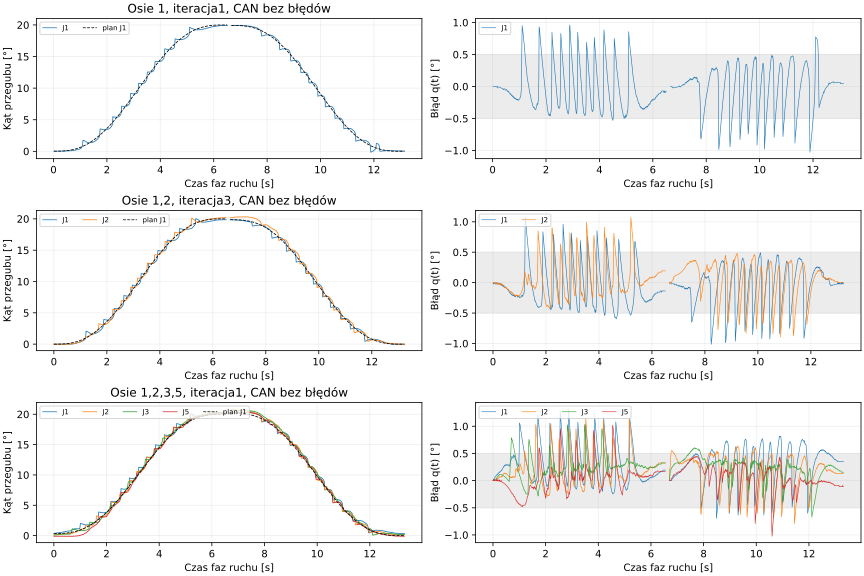
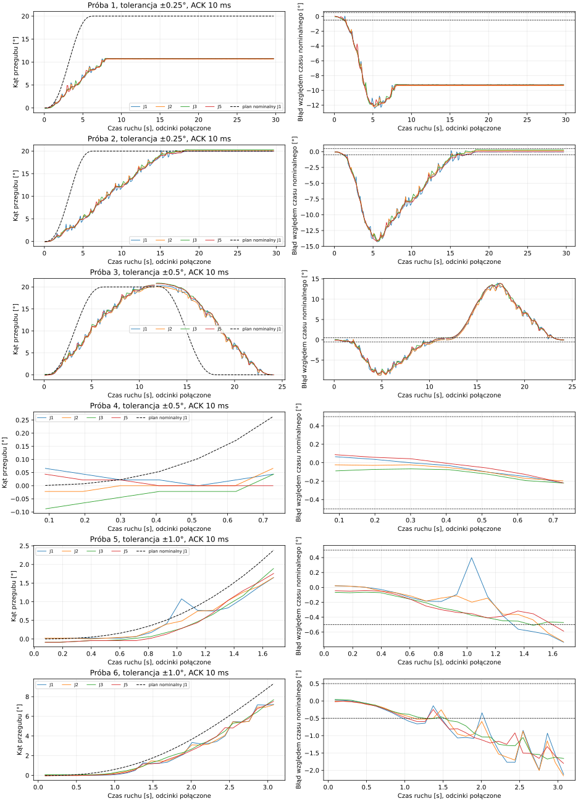
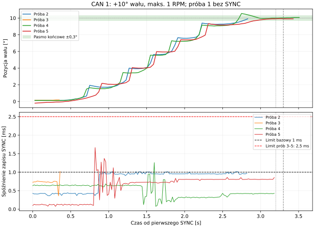

# Odbiór sprzętowy PTP

## Streaming 100 Hz na sprzęcie — 24.10.2026, wdrożenie i próby 1/2/4 osi

Wdrożono produkcyjną usługę z `install/streaming100-ros`; `can0` zachowuje
500000 bit/s, kolejka TX zwiększona 10→1000. Użytkownik uruchomił przygotowany
skrypt administratora. Kontrola HTTP potwierdza cykl 10 ms i motion_use_ack=false.
Nie przełączano CanRate, nie zmieniano ID/prądu/mikrokroków. J4/J6 nie uczestniczą.
Przed próbami użytkownik ponownie potwierdził rozsprzęglenie wałów oraz zakres:
J1→J1+J2→J1+J2+J3 +J5, 0→+20→0° przegubu, maksymalnie 1 RPM wału.

Enkodery wyzerowano w obecnym położeniu przez API. Kalibracja 1/2/3/5 została
unieważniona i utrwalona. Profile testowe: potwierdzone przełożenia 1:1, kierunek +1,
offset 0; holding/max 1 RPM, acc 1, lookahead 25 ms, FF1,15, tolerancja końca ±0,5°.
To ograniczony wariant, **nie odbiór holding 3/max 2500/acc 240**. Przy 1 RPM kod
prędkości jest skwantowany do 1; test nie identyfikuje dynamicznego feed-forward.
Wykorzystano produkcyjną bibliotekę CAN i wykonawcę w osobnym narzędziu C++
przy zatrzymanej usłudze; to nie pełny test uruchomienia z panelu/akcji ROS.

### Przygotowanie i interwencje

Pierwsze przygotowanie ENABLE J1 przerwano przed F5: po `8C 00/00` napęd nie wysyła
ACK F7. Zapis wykazał F7, brak odpowiedzi przez 20 ms, następnie F6(0). Poprawiono
sekwencję na F7 bez ACK, zachowując 32/F1 i pozycje jako potwierdzenie postoju.
Test emulatora przed poprawką FAIL, po PASS; dodatkowo zgubione F7 blokuje
załączenie ENABLE. Po poprawce ENABLE/zero/disable wszystkich czterech osi OK.

Pierwsza próba dwóch osi osiągnęła cele, ale 221 błędów BIT1/controller wyklucza
zaliczenie komunikacji. Ślad: zapytania 31 około 1 ms przed pierwszym F5. Poprawiono
fazę startu (F5 całej grupy przed odczytami). Druga próba przerwała się przy
kolejnej kolizji: F1 wysłane ~1,5 ms przed F5, 17 ramek błędu. Dodano zakaz
rozpoczynania odczytów w ostatnich 4 ms przed następnym F5. To odroczenie zapytań,
bez czekania na pomiar/ACK i bez wstrzymywania trajektorii od odchyłki.
Narzędzie prób od drugiej iteracji przerywa przy błędzie CAN (poza jednoznacznym
powrotem kontrolera do ERROR-ACTIVE). Wcześniejszy success w surowym summary
oznacza tylko cele; poniższa ocena uwzględnia również jakość komunikacji.

### Przebieg prób

Czas lokalny CEST, 24.10.2026. Czas testu obejmuje preflight, wykonawcę i cleanup.
Próba przerwana ma pomiary wyłącznie dla wykonanego fragmentu. Nie było potrzeby
wykorzystania wszystkich sześciu dopuszczonych iteracji; dwie osie zaliczono w 3.

| Test | Osie / iteracja | Początek | Czas [s] | Błąd / przyczyna odrzucenia | Interwencja | Wynik |
| --- | --- | --- | ---: | --- | --- | --- |
| 1 | 1 / 1 | 19:51:57 | 14.742 | Brak; timeouty tylko nieobecnych ID w skanie | Streaming 100 Hz bez ACK; poprawka F7; 1 RPM/acc 1; tolerancja ±0,5° | Cele i komunikacja OK |
| 2 | 1,2 / 1 | 19:53:00 | 14.741 | 221 ramek błędu CAN; cele osiągnięte | Po zaliczeniu J1: dwie osie 100 Hz, bez ACK/SYNC, 1 RPM/acc 1, tolerancja ±0,5° | Niezaliczone |
| 3 | 1,2 / 2 | 19:59:47 | 2.263 | Błąd transportu CAN: Ramka błędu CAN podczas próby; STOP (flags=8) | F5 przed pierwszym 31; wspólna faza 10 ms; STOP przy błędzie CAN; 1 RPM/acc 1 | Niezaliczone |
| 4 | 1,2 / 3 | 20:03:45 | 15.035 | Brak; timeouty tylko nieobecnych ID w skanie | Bez nowych odczytów przez 4 ms przed F5; STOP przy błędzie; ponowne zero; 1 RPM/acc 1 | Cele i komunikacja OK |
| 5 | 1,2,3,5 / 1 | 20:04:40 | 14.896 | Brak; timeouty tylko nieobecnych ID w skanie | Po zaliczeniu 2 osi: cztery osie, przerwa odczytów 4 ms, STOP przy błędzie CAN, 1 RPM/acc 1 | Cele i komunikacja OK |

### Zgodność z trajektorią

Procent oznacza udział **zaakceptowanych odczytów 31** w paśmie ±0,5° przegubu,
liczony względem nominalnego q(t) od pierwszego F5; obejmuje obie fazy i dolot.
Druga miara porównuje z rzeczywistym ostatnim celem F5 (wraz z lookahead), po
konwersji przekładni/kierunku/offsetu. Nie dopasowano przesunięcia czasowego w celu
polepszenia wyniku. To udział próbek, nie procent dokładności modelu ani TCP.
Tabela zawiera zakończone warianty bez błędów CAN: 1,2(3),4 osi.

| Osie | Próbki | Nominalna ±0,5° | Cele F5 ±0,5° | MAE nominalna [°] | Maks. błąd nominalny [°] | Pozycje przy potwierdzeniu powrotu [°] |
| --- | ---: | ---: | ---: | ---: | ---: | --- |
| 1 | 1222 | 85.92% | 80.61% | 0.277 | 1.029 | J1:+0.044 |
| 1,2 | 2354 | 88.11% | 86.41% | 0.250 | 1.079 | J1:-0.022, J2:+0.000 |
| 1,2,3,5 | 4715 | 86.38% | 84.58% | 0.274 | 1.319 | J1:+0.352, J2:+0.132, J3:+0.154, J5:-0.110 |

Dla czterech osi średni błąd bezwzględny wyniósł 0,274°, maksymalny 1,319°.
Maksima odczytu w fazie dodatniej: J1=20,325°, J2=20,874°, J3=20,632°,
J5=20,303°. Przeregulowanie występowało mimo końcowego zaliczenia ±0,5°.
Pochodna kolejnych odczytów enkodera wykazuje skoki wielokrotnie większe od 1 RPM
(nawet kilkanaście RPM). **Ramki F5 były ograniczone do 1 RPM; nie jest to dowód
ograniczenia rzeczywistej chwilowej prędkości.** Bez niezależnego pomiaru nie
rozstrzygamy między ruchem a skokową aktualizacją danych firmware. Płynność i
chwilowa prędkość pozostają nieodebrane.

### Zegar, komunikacja i CPU

Po końcowej poprawce: brak SYNC, brak oczekiwania na ACK F5/F6/F7. W zaliczonych
wariantach 0 błędów CAN i 0 timeoutów odczytów w ruchu; 16/18/19 timeoutów skanu
odpowiada nieobecnym lub pomijanym ID, nie utracie uczestników podczas ruchu.
Poniżej okresy liczone osobno w każdej fazie strumienia, bez przerwy uzbrajania
między ruchem dodatnim a powrotem; nie są to gwarancje twardego RT.

| Osie | F5 średnio / maks. [ms] | 31 średnio / maks. po osiach [ms] | Szczyt rezerwacji CAN | CPU procesu z trace [% rdzenia] |
| --- | ---: | --- | ---: | ---: |
| 1 | 10.001/12.725 | J1:10.63/13.01 | 32.40% | 7.78% |
| 1,2 | 10.000/12.605 | J1:11.19/17.03, J2:11.11/16.92 | 37.00% | 9.37% |
| 1,2,3,5 | 10.000/12.140 | J1:11.12/17.33, J2:11.16/17.33, J3:11.21/19.97, J5:11.32/17.04 | 39.70% | 10.72% |

Odczyty mają nominalny okres 10 ms, lecz w praktyce są rzadsze przez odroczenia
slotów, potok czterech zapytań i przerwę ochronną. Komendy F5 zachowują własny
zegar; nie czekają na te odczyty. Rezerwacja<=40% jest modelem kosztu nadawania
i odpowiedzi, nie pomiarem przewodu. Dla 6 osi i rezerwy modułu 20 punktów nadal
wymagany jest 1 Mbit/s: 26,58% robota +20%=46,58%<60%. Cztery osie 500k mieszczą
model 35,44%, ale same nie potwierdzają przepustowości 6 osi przy 500k.
CPU dotyczy procesu C++ z włączonym trace, nie całego produkcyjnego stosu ROS.

### Stan końcowy i zakres odbioru

Po każdej próbie wysłano STOP i ENABLE=0, odtworzono nastawy; bez zmiany bitrate.
Przywrócono produkcyjny panel z końcową biblioteką. Operator uruchomił końcowy
start usługi po timeoutcie systemowego uwierzytelnienia; końcowy odczyt potwierdza
active/fresh, brak fault/busy, 500k/TX1000, cykl 10 ms i motion_use_ack=false.
Po zdjęciu momentu wały odsunęły się od pozycji potwierdzonych przy ENABLE=1:
J1~+0,549°, J2~+0,198°, J3~+0,220°, J5~+0,176°. To osobny pomiar bez trzymania,
nie wynik kontroli celu podczas ruchu. Kalibracje 1/2/3/5 pozostają nieważne po
zerowaniu. execution_enabled=false: wykonanie z panelu wymaga ponownego
zatwierdzenia kalibracji oraz jawnego włączenia profilu; odbioru TCP nie ogłoszono.

Po poprawkach 109 testów CAN i testy bezpośrednich konsumentów ROS/hardware OK;
łączne zebrane wyniki 331 testów bez błędów (pozostałe wyniki z poprzedniego pełnego
przebiegu, nie nowe testy tej sesji). CPU/przed-po: [benchmarki](benchmark_results.md).
Źródła i surowe dane: `log/hardware-ptp/streaming100-20261024/` (summary, runner,
can-0.jsonl, tracking-samples.csv/JSON, stream-periods.json, analysis.json),
`log/streaming100-deployment/` (buildy, regresje, CPU, konfiguracja i status końca).
Wersja biblioteki końcowych prób: SHA256
`4e8cd2a594d43a1ff71684fa308bf618abbfd522f818fe7c02e559bbe433d586`.

## ACK 10 ms i porównanie tolerancji — 2026-10-24

**Wynik:** jedna z sześciu prób ukończyła +20° i powrót do zera: próba 3,
tolerancja ±0,5°. Dwie próby ±0,25° zatrzymały się w oczekiwaniu na pozycję;
pozostałe przerwał brak ACK mimo 10 ms. **Nie zaliczono niezawodności PTP
czterech osi ani pracy w twardym czasie rzeczywistym.**

ACK został wydłużony do **10 ms** w domyślnych parametrach C++/API ROS,
szablonie i `config/local/execution.yaml`. Zgodnie z doprecyzowaniem użytkownika
plan łączny CAN wynosi **60%**, z osobną rezerwą **20 punktów procentowych dla
przyszłego modułu**. Robot zachowuje maksymalnie 40% planowanych rezerwacji
na cykl; nie otrzymał do wykorzystania tych dodatkowych 20 punktów.
Diagnostyka prędkości/F1 pozostała co 50 ms; odczyty pozycji, ENABLE/stall
co 100 ms. Stare zasady JOG/JTC nie zostały zmienione.

### Procedura i wyniki

Utrzymano zgodę na rozsprzęglone wały J1/J2/J3/J5, zerowanie w postoju przed
każdą próbą, kąt przegubu **0° → +20° → 0°**, rozkazy do **1 RPM wału**,
profil quintic co nominalne 20 ms, odczyt pozycji co 100 ms. Porównano
±0,25°, ±0,5°, ±1°, po dwa powtórzenia. IO we wszystkich próbach: **1 ms**,
bez affinity i bez zmiany prędkości/acc. STOP po błędzie, limit stanowiskowy
30 s na odcinek, wyłączenie i odtworzenie parametrów po próbie.
ACK dokładnie po 10 ms jest spóźniony; niepewnego zestawu nie ponawiano.

Testy korzystały z tej samej produkcyjnej biblioteki managera w osobnym
procesie stanowiskowym. ACK 10 ms i tolerancje przekazywano przez jej istniejącą
konfigurację. Nie podmieniano metod wykonawcy. **Nie jest to test pełnej
ścieżki ROS/planner/HTTP/panel ani fizyczny test sześciu osi.**

Czasy lokalne CEST (UTC+02:00); czas obejmuje przygotowanie, zerowanie i sprzątanie.

| Test | Tolerancja przegubu | Czas testu | Błąd przerwania | Zmiana względem poprzedniej próby | Wynik |
| --- | --- | --- | --- | --- | --- |
| 1 | ±0.25° | 14:31:18–14:31:50; 32.263 s | Limit stanowiska 30 s, waiting_position J3; ruch zatrzymany około 10,7°. | ACK 5→10 ms; tolerancja 0,25°. | Niezaliczony |
| 2 | ±0.25° | 14:32:25–14:32:57; 32.264 s | Limit stanowiska 30 s, waiting_position J3; 318/321 punktów wyjazdu. | Powtórzenie; poprawiony zapis raportu, bez zmiany sterowania. | Niezaliczony |
| 3 | ±0.5° | 14:33:30–14:33:57; 26.590 s | — | Tolerancja 0,25→0,5°. | Cele i procedura końcowa OK |
| 4 | ±0.5° | 14:34:07–14:34:10; 3.330 s | Brak ACK J3, brak SYNC dla niepewnego zestawu. | Powtórzenie bez zmian. | Niezaliczony |
| 5 | ±1° | 14:34:36–14:34:40; 4.241 s | Brak ACK J2, brak SYNC dla niepewnego zestawu. | Tolerancja 0,5→1°. | Niezaliczony |
| 6 | ±1° | 14:34:56–14:35:02; 5.564 s | Brak ACK J2, brak SYNC dla niepewnego zestawu. | Powtórzenie bez zmian. | Niezaliczony |

W próbie 1 po zakończonym STOP/wyłączeniu zapis podsumowania ujawnił błąd
ścieżki względnej. Naprawiono go przed próbą 2. Pierwsze podsumowanie i czas
odtworzono z zachowanych śladów preflight/cleanup i kotwicy UTC/monotonicznej;
jest oznaczone `recovered_summary`, bez niedostępnego pomiaru CPU.
Od próby 2 metadane startu i CPU zapisują się również przed końcowym raportem.
Nie jest to dodatkowy test ruchu i nie zmienia wyniku przerwanej próby.

W próbach ±0,25° ACK miały zapas co najmniej około 5 ms. Mimo to grupa
pozostała w `waiting_position`: zbyt ciasne pasmo może zatrzymać postęp
bez błędu komunikacji. W próbie 2 wykonano 318 z 321 punktów wyjazdu,
ale nie zaliczono +20° i nie rozpoczęto powrotu.

### Procent zgodności z trajektorią

Nie istnieje jeden standardowy procent „zgodności ruchu”. W tym raporcie:

`zgodność = 100% × liczba zaakceptowanych pomiarów z |q_pomiar − q_ref| ≤0,5° / liczba zaakceptowanych pomiarów`.

**Pasmo oceny zawsze wynosi ±0,5°**, niezależnie od testowanej tolerancji.
Nie przyznajemy większego wyniku tylko za poluzowanie ustawienia wykonawcy.
Każda para oś–pomiar jest jedną obserwacją; wyniki zbiorcze są ważone liczbą
próbek. Nie dopisujemy brakujących pomiarów ani nie traktujemy ich jako trafień.
Raport dotyczy obserwowanych próbek około 10 Hz, nie całego przebiegu między
nimi; opóźnienia odpowiedzi i brak znacznika próbkowania w MKS ograniczają ocenę.

Dwie referencje pokazują różne skutki wykonania:

- **Nominalna w czasie:** oryginalny quintic dla rzeczywistego czasu od pierwszego
  SYNC każdego odcinka. Pierwszy SYNC uruchamia punkt t=20 ms, stąd przesunięcie
  fazy +20 ms. Zegar planu nie zatrzymuje się podczas pauz; po nominalnym końcu
  referencja pozostaje w celu. To ocena odtworzenia obliczonej trajektorii w czasie.
- **Uruchomione cele z pauzami:** oryginalny quintic w fazie ostatniego punktu
  uruchomionego przez SYNC. W pauzie cel jest stały. To ocena śledzenia kolejnych
  celów, oddzielona od utraty nominalnego tempa; nie jest odtworzeniem pierwotnego
  przebiegu czasowego.

Wykorzystano wyłącznie pozycje z poprawnym `reply_ok` w trakcie danego odcinka,
po pierwszym SYNC i do sukcesu/przerwania. Zachowano fazę i start każdej osi,
nie wykonywano dopasowania krzywej do pomiarów ani przesuwania jej w celu
zwiększenia zgodności. Średni błąd poniżej to MAE, osobno podano RMSE i maksimum.

| Test | Zakres wyniku | Liczba pomiarów | Zgodność nominalna w czasie | Zgodność z celami po pauzach | MAE nominalny / cele [°] |
| --- | --- | --- | --- | --- | --- |
| 1 | **Tylko fragment przed przerwaniem** | 1165 | 4.03% | 98.11% | 8.713 / 0.182 |
| 2 | **Tylko fragment przed przerwaniem** | 1122 | 51.69% | 95.19% | 3.452 / 0.171 |
| 3 | **Pełne +20° i powrót** | 899 | 21.02% | 85.76% | 4.672 / 0.269 |
| 4 | **Tylko fragment przed przerwaniem** | 28 | 100.00% | 100.00% | 0.095 / 0.080 |
| 5 | **Tylko fragment przed przerwaniem** | 64 | 87.50% | 98.44% | 0.256 / 0.135 |
| 6 | **Tylko fragment przed przerwaniem** | 115 | 37.39% | 96.52% | 0.781 / 0.165 |

**100% w próbie 4 dotyczy zaledwie 28 pomiarów początkowego fragmentu**
i nie oznacza wykonania całego ruchu. Nie porównujemy tego wyniku jako lepszego
od kompletnego przejazdu. Próby 1/2/5/6 również nie dają procentu całej trajektorii.

Dla jedynego pełnego przejazdu (próba 3, ±0,5°): **21,02% zgodności z czasem
nominalnym (189/899), 85,76% zgodności z uruchomionymi celami (771/899)**. MAE/RMSE/maksimum:
nominalnie **4,672° / 6,251° / 13,942°**, względem celów
**0,269° / 0,339° / 1,135°**. Rozjazd czasowy jest głównym powodem niskiego
pierwszego wyniku; poprawne dotarcie do końca nie oznacza zgodności czasowej.

| Oś, pełna próba 3 | Pomiary | Zgodność nominalna | Zgodność z celami po pauzach | RMSE wobec celów [°] |
| --- | --- | --- | --- | --- |
| J1 | 227 | 22.47% | 78.85% | 0.405 |
| J2 | 214 | 22.43% | 90.19% | 0.273 |
| J3 | 229 | 18.34% | 82.97% | 0.344 |
| J5 | 229 | 20.96% | 91.27% | 0.318 |

Planowane odcinki trwały **6,42 + 6,54 = 12,96 s**. Rzeczywisty czas od pierwszego
SYNC do sukcesu każdego odcinka, zsumowany bez przygotowania i przerwy między
nimi, wyniósł **24,007 s**, czyli **85,24% dłużej**. Cała próba trwała 26,590 s.
Nadano 321+327=648 SYNC, zgodnie z pełną liczbą punktów; nie pomijano ich.
Po +20° pomiary wynosiły około 20,171°/20,039°/20,435°/20,369°;
po powrocie około −0,022° na każdej osi. Nie było fałszywego fault JTC po sukcesie.

Wykres łączy oba odcinki tylko w pełnej próbie 3; pozostałe pokazują fragment
wyjazdu. Czarna linia to nominalny plan J1, kolory odpowiadają osiom, a pasmo
±0,5° na prawych wykresach pozostaje wspólne. Dokładne referencje wszystkich osi
są w CSV, nie są zastępowane planem J1 w obliczeniach.

### Budżet sześciu osi i przyszłego modułu

Model: 500 kbit/s, klasyczne ramki, konserwatywnie `55+10×DLC` bitów;
F5 50 Hz wraz z ACK i dodatkowym raportem, SYNC 50 Hz, pozycje 10 Hz,
ENABLE/stall 10 Hz, prędkość/F1 20 Hz. Nie zmieniano tych częstotliwości.

| Osie | Robot — średni model | Rezerwa przyszłego modułu | Razem | Zapas do 60% |
| --- | --- | --- | --- | --- |
| 4 | 22,47% | 20,00% | 42,47% | 17,53 pkt proc. |
| 6 | 33,33% | 20,00% | 53,33% | **6,67 pkt proc.** |

Rozbudowa czterech do sześciu osi mieści się w obecnych 40% robota i nie zużywa
rezerwy przyszłego modułu. Przy pełnym przydziale 40%+20%=60% nadal pozostaje
40% wolnej przepustowości przewodu. Rezerwa nie jest generowanym ruchem:
**nie podłączono modułu, nie wysyłano fikcyjnych ramek i nie testowano jego
arbitrażu ani sześciu fizycznych osi**. Wspólny limit wymaga przestrzegania
przez przyszły moduł; jego bursty i priorytety nie są jeszcze znane.

Koszt zestawu F5/ACK/raportów/SYNC: **2,59 ms dla czterech**, **3,81 ms dla sześciu
osi**. W 10 ms pozostaje odpowiednio 7,41 i 6,19 ms przed dodatkowym ruchem.
Jeśli przyszły moduł zużyje całe 20% cyklu 20 ms w jednym burście, jest to
2000 bitów = 4 ms. Po odjęciu również jednej już rozpoczętej ramki DLC8
(0,27 ms) pozostaje odpowiednio **3,14 i 1,92 ms** na pozostałe opóźnienia.
To warunkowy rachunek, bez retransmisji; średnia 20% nie ogranicza sama z siebie
maksymalnej długości burstu i nie zapewnia deadline 10 ms.

Największy pełny ACK w zaliczonej próbie trwał **5,791 ms**, z zapasem 4,209 ms.
W pozostałych próbach pełne zestawy mieściły się w około 4–5 ms, ale w próbach
4/5/6 zabrakło ACK jednej osi. Analiza potwierdziła brak SYNC dla niekompletnych
zestawów i brak SYNC po fault. **Wynik nie potwierdza 10 ms jako niezawodnej
wartości dla sześciu osi z dodatkowym modułem.**

Szczyt rezerwacji robota wyniósł do 39,9%, poniżej jego 40%. Błędy/stany CAN
w śladach prób: 184/291/586/67/99/182. Liczniki warning wzrosły **157→226**,
passive **139→216**, BUS-OFF pozostał 0; stan końcowy ERROR-ACTIVE. Przyczyna
błędów BIT1 i braków ACK pozostaje do wyjaśnienia. Zmiana tolerancji nie usuwa
błędów transmisji. Nie zmieniano bitrate, terminacji, prądu ani firmware.

### Stan końcowy i zakres wdrożenia

- Wszystkie obecne napędy J1/J2/J3/J5 mają potwierdzone **ENABLE=0**;
  odczytane 82/84/8C/98/4A są zgodne z bazą sprzed tej serii.
- Ostatnia próba została przerwana podczas wyjazdu; nie wykonywano kolejnego
  automatycznego powrotu. Po zwolnieniu momentu odczytano około
  J1 **7,405°**, J2 **7,339°**, J3 **7,932°**, J5 **9,009°**.
- Kalibracja J1/J2/J3/J5 pozostaje nieważna po zleconym zerowaniu.
  Panel/pierwotny stos odtworzono przez zamknięcie własnego launch i istniejący
  restart systemd. API: świeże, bez busy/fault, wszystkie cztery napędy wyłączone.
- Nowy build trzech pakietów w `install/ptp-ack-wait-ros` i lokalny YAML ACK10
  są gotowe. **Nie instalowano override nowego wykonawcy do działającej usługi**;
  przywrócono poprzedni profil uruchomienia, bez automatycznego ruchu.
- Testy: **40 wykonawcy/kompilatora i 3 parametrów ROS OK**, w tym ACK sześciu
  osi przy 9,999/10,000/10,001 ms, odmowa/błędny ACK i blokowanie SYNC.
  Stary test timeoutu 9 ms dostosowano do nowej granicy, bez osłabienia kryterium.
  Sprawdzono również `py_compile`, odmowę uruchomienia bez flag zgody oraz
  analizator na syntetycznej pauzie 100 ms/przerwanym programie/kwantyzacji.
- Procenty nie potwierdzają fizycznego ograniczenia do 1 RPM ani płynności
  między pomiarami 10 Hz. Obowiązuje otwarta kwestia skoków enkodera/dynamiki.
- Zmiany narzędzi: jawne ACK/tolerancja/katalog serii, zapis fazy trajektorii,
  CPU procesu i metadanych startu; nowy `scripts/analyze_ptp_tracking.py`.
  Ślady i wyniki: `log/hardware-ptp/ack10-tolerance-20261024/`, `analysis.json`,
  `tracking.json`, `budget.json`, `build.json`, w katalogach prób również
  `tracking-samples.csv`. Nie utracono zdarzeń trace. CPU sprzętu 6,74–8,59%
  jednego rdzenia w próbach 2–6, dla próby 3 7,23%; próba 1 bez tego pomiaru.
- [Porównanie can.stream4/6 i CPU przed/po](benchmark_results.md#ack-10-ms-i-rezerwa-can--2026-10-24)
  dotyczy tego zadania, nie jest pomiarem twardych gwarancji czasu rzeczywistego.

Wniosek: pozostawić ACK10 jako przygotowaną konfigurację, lecz nie zaliczać
odbioru. Najpierw wyjaśnić błędy CAN i utracone ACK, potem powtórzyć pełne
przejazdy i odebrać sześć osi oraz ruch przyszłego modułu. ±0,25° blokuje postęp,
±1° nie usuwa błędu komunikacji; jedyny pełny wynik ±0,5° nie wystarcza do
potwierdzenia powtarzalności. Dalsze próby wymagają nowego zakresu i zgody.

## Podstawowy PTP — 2026-10-24

**Wynik:** J1 oraz J1+J2 osiągnęły +20° i wróciły do 0° w tolerancji.
Grupa J1+J2+J3+J5 nie uzyskała pełnego zaliczenia w sześciu próbach.
Dwa jej przejazdy spełniły kryteria pozycji i ACK, lecz końcowa procedura
porządkowania zgłosiła błąd. Pozostałe przerwał timeout ACK. Nie zaliczono
płynności ani fizycznego ograniczenia prędkości do 1 RPM.

### Warunki i zakres tej serii

Użytkownik zatwierdził zerowanie enkoderów w bieżącym położeniu, kąty
**przegubów**, rozsprzęglenie wszystkich wałów oraz rozkazy do **1 RPM wału**.
Kolejność: J1 → J1+J2 → J1+J2+J3+J5. Każdy przejazd: 0° → +20° → 0°.
Przyjęto maksymalnie sześć prób **łącznie z pierwszą na etap**, z przejściem
do większej grupy po zaliczeniu poprzedniej. Wykonano dziewięć prób: 1+2+6.
Po wyczerpaniu limitu nie wykonywano dodatkowego ruchu.

- `can0`, 500000 bit/s, MKS SERVO42D; dostępne CAN 1/2/3/5, J4/J6 nie uczestniczyły.
- Potwierdzony aktywny profil: przekładnie 1:1, kierunki +1, offsety 0.
  W tej konfiguracji kąt przegubu jest równy kątowi wału. Limity pobrano
  z istniejącej konfiguracji, bez tworzenia nowych danych mechaniki.
- Mikrokrok 16, polecenia F5 z RPM=1, acc=1. Quintic próbkowany nominalnie
  co 20 ms; kompilator sam wybrał **streamed we wszystkich przejazdach**.
- ACK całego zestawu **<5 ms od początku nadawania**, pozycja nominalnie
  co **100 ms**, tolerancja **±0,5° przegubu**. Nie rozszerzano terminów
  ani tolerancji, nie pomijano punktów w ukończonych przejazdach.
- Zewnętrzny limit stanowiskowy 30 s na odcinek, STOP po błędzie,
  wyłączenie momentu i przywrócenie parametrów po próbie. Ten limit nie
  został dodany do produkcyjnego oczekiwania na pozycję.
- Zerowanie początkowe wykonano przez API; unieważnienie kalibracji
  J1/J2/J3/J5 zostało utrwalone. Przed kolejnymi próbami zerowano wybrane
  osie w potwierdzonym postoju przy ENABLE=0.

Test uruchamiał **rzeczywistą produkcyjną bibliotekę `CanBusManager`** z
`install/ptp-ack-wait-ros`, Release `-O1 -DNDEBUG`, w osobnym procesie C++.
Nie nadpisywano metod wykonawcy ani progów. Transport stanowiska ograniczał
uczestników i kontrolował zakres wysyłanych F5; STOP obejmował CAN 1–6.
Lokalny profil stanowiskowy po zerowaniu nie zmieniał kalibracji zapisanej
w aplikacji i nie ustawił dawnych flag odbioru na true.
**Nie jest to odbiór całej ścieżki planera ROS → HTTP/panel → wykonawca.**
Właściciel CAN panelu był zamknięty, a blokada SocketCAN pozostała aktywna.

### Raport kolejnych prób

Czasy lokalne CEST (UTC+02:00), 24.10.2026. Czas próby obejmuje przygotowanie,
zerowanie, wykonanie i końcową procedurę. Numer po ukośniku oznacza próbę
w obrębie danej grupy. „Cele OK” oznacza potwierdzenie obu końców w paśmie
±0,5°, nie odbiór dynamiki napędów.

| Test / próba grupy | Osie | Czas testu | Błąd przerwania / niezaliczenia | Wdrożona interwencja | Wynik |
| --- | --- | --- | --- | --- | --- |
| 1 / 1 | J1 | 14:01:14–14:01:33; 19.073 s | — | Baza: IO 1 ms. | Cele i sprzątanie OK |
| 2 / 1 | J1+J2 | 14:03:26–14:03:57; 30.858 s | Limit stanowiskowy 30 s: waiting_position J1; 0 SYNC. | Zero przed próbą; grupa J1/J2, IO 1 ms. | Niezaliczony |
| 3 / 2 | J1+J2 | 14:05:02–14:05:24; 22.418 s | — | Po ENABLE ≥1 s i stabilność ≤3 impulsy przez ≥200 ms przed pobraniem startu. | Cele i sprzątanie OK |
| 4 / 1 | J1+J2+J3+J5 | 14:05:43–14:06:00; 17.426 s | Powrót: brak ACK J5; obsługa 5,003 ms. | Stabilizacja jak wyżej; grupa czterech osi, IO 1 ms. | Niezaliczony |
| 5 / 2 | J1+J2+J3+J5 | 14:06:44–14:07:09; 25.234 s | Ruch ukończony; końcowe porządkowanie zgłosiło ramkę CAN 20000004. | IO stanowiska 0,5 ms. | Cele OK; całość niezaliczona |
| 6 / 3 | J1+J2+J3+J5 | 14:07:57–14:08:12; 14.943 s | Powrót: ACK J5 obsłużony po 5,440 ms. | Dodatkowo 50 ms po zamknięciu C++ oraz sekwencyjne potwierdzenia F7, następnie F6. | Niezaliczony |
| 7 / 4 | J1+J2+J3+J5 | 14:08:35–14:08:59; 24.646 s | Ruch ukończony; końcowe porządkowanie zgłosiło ramkę CAN 20000004. | IO stanowiska 0,25 ms. | Cele OK; całość niezaliczona |
| 8 / 5 | J1+J2+J3+J5 | 14:09:51–14:10:12; 21.100 s | Powrót: timeout ACK J1. | Log treści błędów końcowych; powrót CAN_ERR_CRTL_ACTIVE jest informacją, pozostałe błędy nadal przerywają. | Niezaliczony |
| 9 / 6 | J1+J2+J3+J5 | 14:11:00–14:11:03; 3.115 s | Wyjazd: ACK J5 obsłużony po 5,076 ms. | IO 0,2 ms i przypięcie procesu do CPU2. | Niezaliczony |

Pierwsza próba dwóch osi nie wysłała żadnego F5/SYNC. Po ENABLE odczyt
przejściowy J1 został użyty jako początek programu; po stabilizacji wał
znajdował się poza tolerancją tego początku. Interwencja dotyczyła pobrania
startu **w narzędziu stanowiskowym**, bez zmiany produkcyjnego wykonawcy.

W testach 5 i 7 zachowano wynik całości jako niezaliczony. Stare narzędzie
nie zapisało treści ramki `20000004`, więc nie można retrospektywnie uznać
jej za nieszkodliwą. W teście 8 nowe logowanie zarejestrowało
`0040000000007f00`: jest to `CAN_ERR_CRTL_ACTIVE`, powrót do stanu aktywnego.
Nowe narzędzie rozróżnia ten komunikat od error-passive i BUS-OFF.

### Pozycje, ACK i komunikacja

| Test z ukończonym powrotem | Pozycje przy zaliczeniu +20° [°], kolejność osi jak wyżej | Pozycje przy zaliczeniu powrotu [°] | Odcinki +20° / powrót [s] | Maks. czas pełnego ACK [ms] | Min. zapas ACK [ms] |
| --- | --- | --- | --- | --- | --- |
| 1 | 20.083 | -0.022 | 8.948 / 9.571 | 4.114 | 0.886 |
| 3 | 20.105, 20.061 | 0.000, 0.000 | 10.740 / 9.830 | 4.881 | 0.119 |
| 5 | 20.325, 19.907, 20.237, 20.105 | -0.022, -0.022, -0.022, -0.022 | 11.490 / 11.605 | 4.818 | 0.182 |
| 7 | 20.149, 20.149, 20.347, 20.259 | 0.000, 0.000, -0.022, -0.022 | 10.860 / 11.561 | 4.090 | 0.910 |

Nominalne odcinki trwały około 6,4 s; rzeczywiste były dłuższe przez
oczekiwanie całej grupy na pozycję/pomiar. Liczby SYNC w ukończonych parach:
643, 642, 647 i 647, zgodne z liczbą skompilowanych punktów obu odcinków.
Nie zaobserwowano fałszywego błędu JTC pomiędzy sukcesem +20° a kolejnym PTP.

W testach 4, 6 i 9 spóźniony ACK dotyczył J5; w teście 8 timeout dotyczył J1.
W teście 6 ACK J5 był w jądrze przed terminem, lecz został obsłużony około
**3,270 ms później**, po 5,440 ms od początku zestawu. W teście 9 opóźnienie
jądro → proces wyniosło około 2,896 ms. Skracanie okresu obsługi i affinity
nie zagwarantowało terminu. **Nie wysłano SYNC dla żadnego niekompletnego
zestawu ani po błędzie przerwania. Nie ponawiano niepewnego zestawu.**

Modelowy szczyt rezerwacji wyniósł **25,8% dla J1, 31,1% dla zaliczonej
próby dwóch osi oraz 39,9% dla czterech osi**, wraz z przygotowaniem.
To rezerwacja harmonogramu, nie zmierzona zajętość przewodu. Średni model
budżetu z projektu nie gwarantuje spełnienia krótkiego okna ACK.
**5 ms koliduje tu z zaobserwowanymi opóźnieniami procesu już dla czterech osi.**
Nie testowano sześciu osi i nie potwierdzono ich wykonalności przy 5 ms.

Nominalne odczyty pozycji 100 ms występowały z opóźnieniami i utratami:
w pełnej czteroosiowej próbie 5 średnie odstępy wyniosły około 102–105 ms,
maksymalnie 206,84 ms. Timeout pozycji powodował oczekiwanie i późniejsze
wznowienie, bez samodzielnego przerwania programu. Krótsze odstępy w całej
sesji obejmują granicę dwóch odcinków i przygotowanie; nie są okresem
odpytywania w trakcie ustalonego ruchu.

CAN zapisał błędy protokołu `CAN_ERR_PROT_BIT1` oraz przejścia warning/passive
w próbach wielu osi. Liczby ramek błędów/stanu w śladzie ruchu dla testów
1–9: **0, 0, 201, 378, 637, 400, 630, 483, 35**; zawierają również informacje
o powrocie do stanu aktywnego. Przyczyna fizyczna nie została rozstrzygnięta;
nie należy utożsamiać ich z samym obciążeniem magistrali. Końcowe liczniki
`can0`: warning **157**, passive **139**, BUS-OFF **0**, stan ERROR-ACTIVE.
Nie zmieniano bitrate, terminacji, mikrokroku, prądu ani firmware.

**Rozkaz 1 RPM nie potwierdził fizycznego ograniczenia do 1 RPM.**
Różnice kolejnych odpowiedzi enkodera dają estymaty około 2,7–3,0 RPM,
a maksymalny odczyt J1 w teście 5 wyniósł **21,687°** mimo celu +20°.
To wymaga osobnego pomiaru dynamiki/aktualizacji enkodera; nie zaliczono
płynności ani ograniczenia prędkości na podstawie samych rozkazów F5.
Przekroczenie pasma pozycji zgodnie z założeniem wstrzymywało kolejne cele,
bez STOP z samej odchyłki.

### Stan końcowy, narzędzia i dalsze kroki

- Wszystkie obecne napędy J1/J2/J3/J5: **potwierdzone ENABLE=0**.
  Odczytane parametry 82/84/8C/98/4A zgodne z bazą sprzed serii:
  tryb 05, mikrokrok 16, odpowiedzi 01/01, watchdog 300 ms, synchronizacja 0.
- Końcowe pozycje po zwolnieniu momentu: J1 −0,132°, J2 −0,264°,
  J3 −0,198°, J5 +0,022°. Nie są to wyniki zaliczenia końca wcześniejszych prób.
- Panel i pierwotny stos ROS odtworzono przez zamknięcie własnego launch
  i jego istniejący automatyczny restart systemd. API potwierdziło świeże
  odczyty, brak busy/fault oraz ENABLE=0. Nie uruchomiono automatycznego ruchu.
- Rewizja profilu pozostała `d33a621cee7945719bc9c0f342d2c4bb`.
  **Kalibracja J1/J2/J3/J5 jest nieważna po zleconym zerowaniu**; do ruchu
  przegubów w panelu potrzebne jest ponowne potwierdzenie odniesienia.
  Nie instalowano override nowej biblioteki do usługi i nie zaliczono flag odbioru.
- Nowe narzędzia: `scripts/ptp_group_hardware.cpp`,
  `scripts/run_ptp_group_trial.py`, `scripts/analyze_ptp_group_trials.py`.
  Biblioteka SHA-256 `8cca3bef20c85118131a46de7ebb24a1c42383e876683cee1227513a2039978a`.
  Źródła C++ przed/po stabilizacji oraz ich SHA są w lokalnym katalogu serii.
- Ślady lokalne: `log/hardware-ptp/group-20261024/`, po jednym katalogu
  `axes-…-attempt-…`: `runner.jsonl`, `can-0.jsonl`, `preflight.jsonl`,
  `cleanup.jsonl`, `summary.json`; analiza `analysis.json`, stan końcowy
  `final-raw-check.json`, `final-can.txt`, `restored-api.json`. Brak utraconych
  zdarzeń trace. Timeouty skanu nieobecnych/odfiltrowanych adresów 1–20
  rozdzielono od timeoutów aktywnego PTP.
- Sprawdzenia tej sesji: kompilacja narzędzia C++ `-O1`, `py_compile`, odmowa
  uruchomienia C++ bez flag zgody, cztery scenariusze RX na gniazdach UNIX
  (powrót ACTIVE, error-passive, poprawna odpowiedź, zła suma). Próba tych
  gniazd w sandboxie była niedostępna; powtórzenie poza sandboxem przeszło.
  Nie powtarzano wcześniejszych testów całego ROS ani panelu.
- Nie mierzono CPU procesu w tej serii ani porównywalnej bazy wydajnościowej
  dla zmiany okresu IO. Czasy prób nie są benchmarkiem; zobacz
  [ograniczenia porównania](benchmark_results.md#próby-stanowiskowe-ptp--2026-10-24).

Następny krok: ustalić przyczynę błędów BIT1 i opóźnień odbioru procesu,
zmierzyć dynamikę przy pojedynczym celu oraz ponownie odebrać streamed dla
czterech osi. Samo skrócenie sleep lub zaliczenie pojedynczego przejazdu
nie usuwa problemu. `native_ptp`, pełna ścieżka ROS/panel i sześć osi wymagają
osobnego odbioru; następne próby sprzętowe wymagają nowego zakresu i zgody.

## Seria z 2026-10-21 — wynik historyczny

Wynik z 2026-10-21: **przerwany na jednym silniku; nie zaliczono odbioru PTP**.
Nie uruchamiano etapów dwóch i czterech silników po wykryciu ruchu po sekwencji
kasowania bufora. Fizyczny wykonawca ROS pozostaje wyłączony.

## Stanowisko i zatwierdzona procedura

Użytkownik potwierdził rozsprzęglenie silników i zatwierdził kolejność CAN 1,
1+2, następnie 1+2+3+5. Zatwierdzone parametry: dodatni kierunek enkodera/CW,
nominalnie +5° wału od bieżącego startu i powrót, najwyżej 1 RPM, nadzór celu
3 s, sprawdzenie F7/STOP i braku ruchu przed SYNC. Błąd przerywa dalsze etapy.
Nie jest to test geometrii, TCP, planera ani pętli wykonawcy ROS.

- Wykryte i odczytane CAN 1, 2, 3, 5: SERVO42D, firmware 1.0.9,
  kalibracja napędu zgłoszona jako poprawna, mikrokrok 16.
- `can0`, U2C/gs_usb, 500000 bit/s, stan ERROR-ACTIVE, brak nowych błędów
  magistrali, przejść error-passive i bus-off podczas prób.
- Przed testem wszystkie cztery napędy miały ENABLE=0, SR_vFOC,
  odpowiedzi 8C=01/01, watchdog 300 ms i synchronizację 4A=0.
- Narzędzie: `scripts/test_ptp_hardware.py`; jeden właściciel z blokadą
  `/tmp/robot-can-<uid>-can0.lock`, bez równoległego nadawania przez diagnostykę.
  Proces diagnostyki zamknięto SIGINT; po próbie odtworzono stos przez zamknięcie
  własnego launch i istniejącą politykę restartu systemd. Sudo wymagało hasła;
  nie korzystano z podwyższenia uprawnień użytkownika.
- Zadano F5 z raw RPM=1, acc=1. Cel nominalnych 5° kwantyzuje się do 228
  impulsów enkodera (5,0098°). Nie zmieniano mikrokroku ani zera wału.

## Wyniki

| Etap | Wynik | Obserwacja |
| --- | --- | --- |
| Przygotowanie CAN 1, próba pierwsza | Przerwane przed F5 | Po ENABLE wał nadal się stabilizował; 248→235 impulsów w 150 ms, około 0,29°. STOP i wyłączenie potwierdzone. |
| Przygotowanie CAN 1, próba druga | Zakończone | Narzędzie czeka na 100 ms stabilności w paśmie 3 impulsów, maksymalnie 2 s. Parametry ruchu bez zmian. |
| F5/ACK przed SYNC, CAN 1 | Zaliczone w tej próbie | ACK `F5 05`, pozycja 238 impulsów przez około 120 ms, brak wykonania przygotowanego celu. |
| F7 po przygotowaniu, potem SYNC | **Niezaliczone** | ACK F7=1; późniejszy SYNC spowodował narastanie pozycji 238→245 w około 54 ms. Próg przerwania: ponad 5 impulsów od pozycji sprzed SYNC. |
| F7 podczas normalnego przejazdu, pełne +5° i powrót | Niewykonane | Procedura przerwana wcześniej. |
| Dwa silniki: CAN 1+2 | Niewykonane | Warunek przejścia z jednego silnika nie został spełniony. |
| Cztery silniki: CAN 1+2+3+5 | Niewykonane | Jak wyżej. |

Ślad drugiej próby, czasy względem potwierdzenia przygotowania F5:

| Czas | CAN | Zdarzenie |
| --- | --- | --- |
| −0,83 ms | 1 | Wysłano `F5 00 01 01 00 01 CE C7`, cel 462 impulsy. |
| −0,15 ms | 1 | Odebrano `F5 05 FB`. |
| 2–114 ms | 1 | Odczyty pozycji: 238 impulsów. |
| 122,71 ms | 1 | Wysłano F7; ACK=1 po około 0,67 ms. |
| 124,67 ms | 0 | Wysłano `4B 4B` — sprawdzenie skasowania przygotowanego rozkazu. |
| 126,57–178,14 ms | 1 | Odczyty 238, 240, 240, 241, 243, 245. |
| 178,41 ms | 1 | Awaryjne F7; następnie F3=0 i 4A=0. |

Przesunięcie wykryte po SYNC wyniosło 7 impulsów, około 0,154°.
Wniosek z tej próby: **ACK F7=1 nie stanowi potwierdzenia opróżnienia
przygotowanego polecenia F5**. Nie potwierdzono skutecznego kasowania bufora
inną sekwencją. Nie jest to pomiar dokładności wspólnego startu ani płynności.

## Stan końcowy i dalsze warunki

Po obu próbach STOP i ENABLE=0 potwierdzono dla CAN 1, 2, 3, 5. Odtworzono
odczytane przed próbą tryb, odpowiedzi 8C, watchdog i 4A; cleanup obu prób
zakończył się bez błędów. Końcowy odczyt panelu: świeży stan, brak zajętości
i fault, wszystkie obecne napędy wyłączone, prędkości wyznaczane z enkoderów
bliskie zeru. `robot-web-status.service` ponownie aktywna. Rewizja aktywnej
konfiguracji pozostała bez zmian; nie zapisywano profilu ani flag odbioru.

Ślady lokalne, pomijane przez Git:
`log/hardware-ptp/20261021-224713.jsonl` i
`log/hardware-ptp/20261021-224743.jsonl`.

Następny krok: ustalić i osobno sprawdzić na jednym wałku sekwencję bezpiecznego
usuwania/zastępowania przygotowanego rozkazu. Dopiero po potwierdzeniu braku
starego ruchu po SYNC i testu zatrzymania można ponowić +5°/powrót oraz przejść
do 2 i 4 silników. Nie ustawiać `execution_staged_reset_verified=true`
na podstawie samej odpowiedzi F7.

Podstawa formatu ramek: [instrukcja producenta MKS CAN V1.0.9, §9.2.3 i §12.3](https://github.com/makerbase-motor/MKS-SERVO42D-57D/blob/master/User%20Manual/V1.0.9/MKS%20SERVO42%2657D_CAN%20User%20Manual%20V1.0.9.pdf).
Powyższe zachowanie bufora wynika z pomiaru, a nie z deklaracji instrukcji.

## Zmiana procedury — 2026-10-22, bez nowej próby sprzętowej

Na polecenie użytkownika procedura STOP/kasowania przygotowanego celu otrzymała
sekwencję: F7 do wszystkich CAN 1–6, następnie F6 z RPM=0 do wszystkich CAN 1–6.
Nie wysyła przy tym SYNC i nie załącza ENABLE. Wykonawca zbiera osobno ACK obu
faz; brakujące lub negatywne odpowiedzi są raportowane. Po najwyżej dwóch
okresach timeoutu kończy nadawanie. Samo ACK nadal nie uprawnia do ustawienia
`execution_staged_reset_verified`.

Narzędzie `scripts/test_ptp_hardware.py` używa tej sekwencji przed próbą SYNC,
przy STOP w ruchu oraz w cleanup. Pozostałe napędy mogą zwrócić odmowę F6 przy
ENABLE=0; zapisujemy odpowiedź, bez załączania momentu. Wymagane ACK dotyczą
osi uczestniczących w danym etapie. Próba kasowania nadal kontroluje brak
starego ruchu po późniejszym SYNC i przerywa procedurę po przekroczeniu progu.

Nie wykonano nowego ruchu, resetu sprzętu ani odbioru tej sekwencji. Wynik próby
z 2026-10-21 pozostaje niezaliczony. Kolejny krok sprzętowy: osobny odbiór
F7 → F6(0) na jednej rozsprzęglonej osi, a po jego zaliczeniu kolejne etapy.

## Seria limitów — 2026-10-22

Wykonano **pięć prób PTP na CAN 1**, w tym jedną odrzuconą przed pierwszym
SYNC. Ostatnia spełniła końcowe kryteria stanowiska. Nie jest to pełny odbiór
robota, jego płynności ani aktywacja wykonania w panelu.

### Zgoda, zakres i warunki

Użytkownik zatwierdził CAN 1/J1, dodatnie +10° **wału**, maksymalną nastawę
1 RPM, rozsprzęglone wały i do pięciu prób. Przed każdą próbą wykonywano
funkcję `ManualMotorController::zero()` odpowiadającą „zeruj wał”. Pierwsze
zerowanie wykonano także przez istniejący endpoint panelu; potwierdzono 0°
i trwałe unieważnienie odniesienia przegubu CAN 1.

Kryteria serii: przeregulowanie dozwolone, tolerancja **końcowa ±0,3°**,
wymaganie RPM=0 dopiero po nominalnym końcu +100 ms. Zachowano dodatkowe
100 ms potwierdzania stabilnego końca i limit końca +1 s. Wyłączono odrzucanie
za przejściowy błąd śledzenia w izolowanym wariancie; nie oceniano tym samym
produkcyjnego nadzoru śledzenia podczas ruchu.

Profil quintic trwał 3,2 s, miał 160 odcinków po 20 ms i teoretyczny szczyt
0,977 RPM. Kompilator automatycznie wybrał `streamed`; ramki F5 miały najwyżej
raw RPM=1 przy odczytanym mikrokroku 16. Cel 10° kwantyzuje się do 455 impulsów
enkodera (9,99756°). Tolerancję oceniano względem nominalnych 10°.

Stanowisko używało rzeczywistych `CanBusManager`, kompilatora, kontrolera
ręcznego i transportu SocketCAN, bez akcji ROS i planera TCP. Proces widział
wyłącznie CAN 1; zapytania/odpowiedzi pozostałych napędów były filtrowane.
STOP nadal wysyłano do CAN 1–6. Profil 1:1 opisywał współrzędną samego wału,
nie zastępował konfiguracji geometrii robota. Pozostałe obecne napędy 2, 3 i 5
wyłączono przed próbami. Zachowano jednego właściciela magistrali.

### Wyniki i zmiany między próbami

| Próba | Zmienione warunki względem poprzedniej | Wynik | Dowód / przyczyna |
| --- | --- | --- | --- |
| 1 | Bazowe czasy: SYNC +1 ms, diagnostyka do 18 ms; końcowe kryteria jak wyżej | Niezaliczona, 0 SYNC | Uzbrajanie odrzuciło odczyt `32 FF FF` = −1 RPM przed startem. To warunek wartości, nie timeout. Enkoder był wyzerowany; rozkaz ruchu nie ruszył. |
| 2 | Przed startem pozostawiono potwierdzenie postoju F1 i stabilność enkodera; dokładne RPM=0 wymagane po końcu +100 ms. Bez zwiększenia czasów | Niezaliczona, 142 SYNC | Spóźnienie SYNC około **1,782 ms >1 ms**. Pozycja przy przerwaniu 9,910°. Komplet ACK był dostępny. |
| 3 | Tylko dopuszczalne spóźnienie SYNC: **1 →2,5 ms** | Niezaliczona, 19 SYNC | Odczyt F1 obsłużono po **2,093401 ms** przy dostępnym czasie **2,049027 ms**; przekroczenie 44,374 µs. Pozycja 0,176°. |
| 4 | Koniec odpowiedzi diagnostyki **18 →19 ms**, minimalny zapas na odpowiedź **2 →3 ms**. Nadawanie nadal [14,16) ms; rezerwa końcowa 2 →1 ms | Niezaliczona jako cała próba, 160 SYNC | Czasowo poprawna i cel spełniony: RPM=0, około 10,042° przy pierwszej ocenie końca. Potem fałszywy błąd śledzenia ze ścieżki JTC. |
| 5 | Izolowana poprawka przejścia po sukcesie: zapamiętanie źródła PTP na początku iteracji IO. Bez kolejnego zwiększania czasów | **Kryteria końcowe zaliczone**, 160 SYNC | Pozycja **9,90967°**, błąd **−0,09033°**, RPM=0. Maks. spóźnienie SYNC **1,63709 ms <2,5 ms**. |

Próba 4 ujawniła błąd w `CanBusManager::tick()`: `schedule_program()` po sukcesie
ustawia `active_=false` i `source_=none`. Dalszy kod tej samej iteracji uznaje,
że nie obsługuje już PTP, i porównuje pozycję ze starym `committed_positions_`
ścieżki JTC, tutaj z 0°. Powstaje „Przekroczony błąd śledzenia osi”, choć cel
PTP został osiągnięty. Poprawkę przetestowano tylko w wariancie stanowiskowym;
**źródła wykonawcy produkcyjnego nadal wymagają poprawki i regresji**.

Wariant próby 4 wymagał poprawienia brakującego nagłówka podczas kompilacji.
Nieudane uruchomienie przed zbudowaniem pliku nie wysłało ruchu i nie stanowi
dodatkowej próby PTP.

### Pomiary czasowe i ograniczenia wyniku

W próbie 5:

- Odstępy zapisów SYNC: średnio **20,0047 ms**, min. **19,0931 ms**,
  maks. **21,5656 ms**, odchylenie standardowe **0,2307 ms**.
- Odstępy zapytań enkodera podczas nominalnego ruchu: średnio **40,0089 ms**,
  min. **39,2985 ms**, maks. **40,6977 ms**. Maksymalny RTT enkodera 2,0973 ms.
- Maksymalny RTT ACK F5 podczas ruchu: **3,2283 ms**. Minimalny zapisany
  margines ACK do SYNC: **16,2068 ms**; to inny punkt odniesienia niż deadline
  okna ACK 8 ms. Nie naruszono okna ACK.
- Maksymalne odstępy odczytów: ENABLE **120,0875 ms**, stall **120,0332 ms**,
  prędkość **79,0122 ms**, F1 **60,2415 ms**. To nominalne okresy rozłożone na
  cykle; nie są równymi odstępami 100/50 ms. Nie wystąpiła utrata świeżości.
- Maksymalny RTT odczytu prędkości podczas ruchu: **3,9717 ms**, przy nowym,
  wydłużonym oknie bez timeoutu. Pierwszy zapis oceny RPM=0 wykonano około
  **117,7 ms po nominalnym końcu**, następnie potwierdzano stabilny koniec.
- Modelowy szczyt rezerwacji całej sesji: **25,8%**, poniżej 40%. To wynik
  jednego uczestnika, obejmujący również przygotowanie; nie dowodzi budżetu
  sześciu osi i nie jest pomiarem zajętości przewodu.

W próbie 3 znacznik odbioru jądra poprzedzał obsługę spóźnionej odpowiedzi F1
w procesie o około **0,767 ms**. Wskazuje to na udział opóźnienia obsługi RX,
a nie dowodzi, że napęd lub przewód odpowiedział po swoim terminie. Czasy
wywołań SocketCAN nie są sprzętowym pomiarem transmisji ani próbkowania.

Odczyt pozycji pokazuje **skokowy przebieg**. W próbie 4 szczyt wyniósł
**10,5469°**; przeregulowanie było dopuszczone i pozycja wróciła do pasma.
W próbie 5 największa różnica kolejnych odpowiedzi enkodera to **1,56006°
w 41,0923 ms**, co odpowiada estymacie około **6,33 RPM**. Nie potwierdza to
utrzymania fizycznej prędkości ≤1 RPM, mimo ograniczenia rozkazów do 1 RPM.
Potrzebna jest osobna weryfikacja dynamiki napędu i chwili aktualizacji danych
enkodera. **Zaliczenie końca nie oznacza zaliczenia płynności.**

Wykres pokazuje nadane SYNC. Odrzucony termin ze spóźnieniem 1,782 ms w próbie 2
nie ma punktu, ponieważ ramki nie wysłano.

### Odbiór STOP i interpretacja odpowiedzi

Przed serią wykonano dodatkowe sprawdzenia przygotowania i kasowania celu,
bez pełnych przejazdów PTP. F6 przy wyłączonym/nieprzygotowanym napędzie zwracało
`00`, a po przygotowaniu CAN 1 i włączeniu `4A=1` zwróciło **`05`**. Producent
opisuje `05` jako przyjęcie danych do synchronizacji, nie potwierdzenie postoju
([instrukcja MKS V1.0.9, §10.1 i §12.3](https://github.com/makerbase-motor/MKS-SERVO42D-57D/blob/master/User%20Manual/V1.0.9/MKS%20SERVO42%2657D_CAN%20User%20Manual%20V1.0.9.pdf)).

Pierwsze kontrole odrzucono z powodu wymagania ACK F6=1 oraz starego progu
bezruchu 5 impulsów (0,1099°). Następnie zastosowano pasmo 0,3° z bieżącego
zlecenia, zachowując zapis surowej odpowiedzi `05` jako odbioru synchronicznego.
Po kontrolnym SYNC odczytano po 100 ms F1=1 i RPM=0; przez sekundę pozycja
zmieniła się maksymalnie o 6 impulsów (0,13184°), bez wykonania celu +10°.
To ograniczony odbiór jednego wału w tym paśmie, a nie dowód zerowego ruchu.

Produkcyjna procedura STOP uznaje obecnie tylko `01` za dodatnią odpowiedź F6,
więc `05` oznacza w jej statystykach niepotwierdzony STOP. Nie należy utożsamiać
tego z timeoutem ani automatycznie zaliczać `05` jako zatrzymania. W próbach
1–3 jej komunikacja kończyła się w około 4–5 ms; po STOP nie było dalszego SYNC.
W próbie 4 błąd wystąpił już po wyłączeniu `active_`, więc sprzątanie wykonała
również zewnętrzna procedura F7 →F6(0) →ENABLE=0. Po każdej próbie odpowiedzi
ENABLE=0 wszystkich obecnych napędów były potwierdzane.

### Narzędzie, ślady i stan końcowy

- Narzędzia: `scripts/build_ptp_limits.py`, `scripts/ptp_limits_hardware.cpp`,
  `scripts/ptp_limits_session.py`. Budowanie tworzy kopie z jawnymi zmianami
  w `/tmp`; nie podmienia pakietów ani konfiguracji ROS.
- Bazowa biblioteka z `install/can-schedule-ros` jest wcześniejszym Release -O1.
  Nadpisane metody stanowiskowe i narzędzie skompilowano GCC 11 z **-O0**.
  Wyniki dotyczą tego procesu testowego, nie deterministyczności usługi ROS.
  Nie wykonywano porównania wydajności ani pomiaru CPU procesu.
- Lokalne ślady: `log/hardware-ptp/limits-20261022/`, katalogi `trial1`, `trial2`,
  `trial3`, `trial4-run`, `trial5`; podsumowanie `analysis.json`, kopie zmienionych
  metod i `build.json` z argumentami oraz SHA-256. Ślady nie utraciły zdarzeń.
  Każda sesja ma 38 oczekiwanych timeoutów skanu odfiltrowanych adresów
  (start i bootstrap); dodatkowy timeout aktywnego PTP wystąpił tylko w próbie 3.
- Sprawdzenia narzędzia: kompilacja wariantów, `py_compile`, trzy istniejące
  testy sekwencji STOP na atrapach i kontrola odmowy uruchomienia bez flag zgody.
  Nie powtarzano wcześniejszych 128 testów ROS ani buildów panelu.
- `can0`: ERROR-ACTIVE, bez wzrostu liczników bus-error, error-warning,
  error-passive i BUS-OFF w tej serii. Nie wykonywano iniekcji USB/BUS-OFF,
  utraty ACK ani próby `native_ptp`, dwóch lub czterech uczestników.
- Panel odtworzono przez zamknięcie dotychczasowego launch i jego istniejący
  automatyczny restart systemd. Końcowy odczyt API: świeży, bez busy/fault,
  CAN 1/2/3/5 z **ENABLE=0**. Po odpuszczeniu momentu CAN 1 wskazywał około
  9,338°; wynik 9,910° pochodzi sprzed STOP/wyłączenia momentu.
- Rewizja konfiguracji i pliki wykonania pozostały bez zmian. Kalibracja CAN 1
  została prawidłowo unieważniona i utrwalona wskutek zleconego zerowania;
  powrót do ruchu przegubu wymaga ponownego potwierdzenia odniesienia.
  Ulotne dopuszczenie testu nie ustawia flag odbioru w aplikacji produkcyjnej.

Następny krok: poprawić i objąć regresją przejście PTP →stan spoczynkowy oraz
rozróżnić w diagnostyce odbiór F6=05 od zatrzymania. Osobno zbadać skokowy
przebieg pozycji. Dopiero wtedy rozważać przeniesienie przetestowanych nastaw
2,5 ms / 19 ms do wykonawcy i odbiór kolejnych osi; pojedyncza udana próba
nie wyznacza maksymalnych opóźnień ani bezpiecznych nastaw całego robota.
