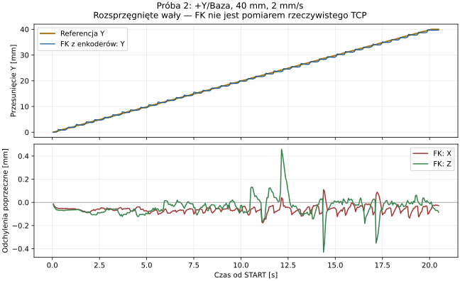
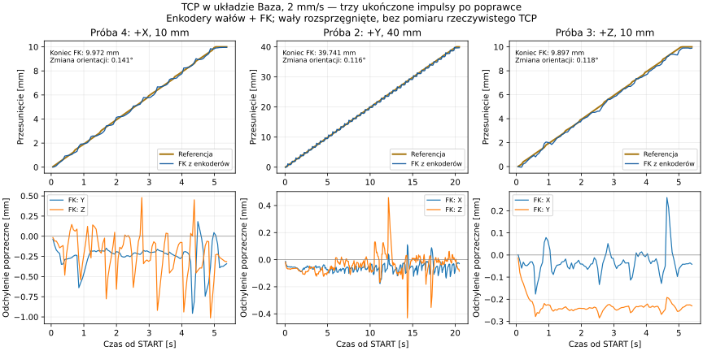

# Raport diagnostyki JOG TCP i zbiorczego ENABLE — 26.10.2026

## Zakres i warunki

Operator zgłosił rozsprzęgnięte wały i załączone silniki. Przed pierwszą próbą
API potwierdziło sześć dostępnych, skalibrowanych osi, ENABLE, świeże pomiary,
0 RPM i brak aktywnego JOG/programu. Aktywna nakładka: `install/tcp-settings-ros`;
`tcp_jog_enabled=true`, stan TCP `ready`. Aktywna rewizja konfiguracji:
`2f1186d77ba44f838f65e261aeabd866`.

Zapisane limity TCP: 100 mm/s, 100 °/s, 100 mm/s², 100 °/s².
Próbę 1 wykonano przy 2 mm/s, kroku 10 mm w układzie Baza, z zachowaniem orientacji,
limitem czasu 10 s, podtrzymaniem co 50 ms i aktywnymi watchdogami właściciela CAN.
Operator osobno zatwierdził ten konkretny ruch +X.

Przesunięcia TCP w tym raporcie są obliczone przez FK z odczytów enkoderów wałów
oraz zatwierdzonej geometrii/przełożeń. Przy rozsprzęgniętych wałach nie stanowią
pomiaru przestrzennego rzeczywistego narzędzia ani odbioru dokładności robota.
Nie zmieniano geometrii, kalibracji, przełożeń ani limitów mechanicznych.

## Próby fizyczne (maksymalnie sześć)

| Nr | Kierunek / krok | Prędkość | Tolerancje IK m / rad | Postęp referencji | FK z pomiarów: ΔX / ΔY / ΔZ | Wynik |
| --- | --- | --- | --- | --- | --- | --- |
| 1 | Baza +X / 10 mm | 2 mm/s | 1e-9 / 1e-8 | 3,820 mm | +3,682 / −0,047 / +0,071 mm | Impuls przerwany przez anulowanie obliczeń; postój potwierdzony, CAN bez awarii |
| 2 | Baza +Y / 40 mm | 2 mm/s | 1e-8 / 1e-7 | 40,000 mm | −0,040 / +39,741 / −0,070 mm | Pełny impuls, postój potwierdzony, CAN bez awarii |
| 3 | Baza +Z / 10 mm | 2 mm/s | 1e-7 / 1e-6 | 10,000 mm | −0,036 / −0,227 / +9,897 mm | Pełny impuls, postój potwierdzony, CAN bez awarii |
| 4 | Baza +X / 10 mm | 2 mm/s | 1e-6 / 1e-5 | 10,000 mm | +9,972 / −0,289 / −0,375 mm | Pełny impuls, postój potwierdzony, CAN bez awarii |

Zmiana orientacji wyznaczona z FK w próbie 1: 0,0829°.
Zmiany odczytów przegubów J1–J6: −0,01099°, +0,85034°, −0,87231°,
+0,01099°, +0,03516°, −0,09668°.
Po zakończeniu generatora spóźnione KEEPALIVE otrzymywały odpowiedź
„Brak pasującego wykonania JOG TCP”; klient nie ponawiał START. Te odpowiedzi
po zakończeniu wykonania nie oznaczają przerwania impulsów 2–4.

Próbę 2 operator zatwierdził oddzielnie po zmianie zakresu z 10 na 40 mm,
łącznie z wydłużeniem maksymalnego czasu z 10 do 25 s. Czas od START do
statusu potwierdzającego postój: 20,314 s. Niedojazd wyznaczony z FK w Y:
0,259 mm; zmiana orientacji 0,1164°. Wysłanie pełnej referencji 40 mm nie oznacza
idealnego wykonania tej drogi przez napędy. Przy zakończeniu obowiązuje dotychczasowa
tolerancja przegubów i potwierdzenie 0 RPM; nie zwiększano jej w tej próbie.
Zmiany zmierzonych przegubów J1–J6: +7,56958°, +0,60645°, −0,60864°,
−9,99316°, +0,70532°, +12,41455°.



Próby 3 i 4 operator zatwierdził osobno przed ich wykonaniem. Obie odbyły się
przy 2 mm/s, 100 mm/s² i limicie 10 s, z potwierdzeniem postoju pomiędzy ruchami.

| Próba po poprawce | Czas do potwierdzenia postoju | Zmiana orientacji FK | Niedojazd w kierunku ruchu | Końcowe odchylenie poprzeczne (norma) | Maks. odchylenie poprzeczne z próbek FK |
| --- | --- | --- | --- | --- | --- |
| 2: +Y 40 mm | 20,314 s | 0,1164° | 0,259 mm | 0,080 mm | 0,460 mm |
| 3: +Z 10 mm | 5,237 s | 0,1180° | 0,103 mm | 0,230 mm | 0,329 mm |
| 4: +X 10 mm | 5,214 s | 0,1409° | 0,028 mm | 0,474 mm | 1,081 mm |



Ukończenie impulsów i potwierdzenie postoju nie są potwierdzeniem idealnej
dokładności kartezjańskiej: w ostatniej próbie końcowa norma odchylenia
poprzecznego wyniosła 0,474 mm, a maksymalna norma z próbek w trakcie ruchu
1,081 mm. Zwiększano wyłącznie dopuszczalny błąd
**zbieżności IK**, a nie tolerancję śledzenia napędów. Końcowa tolerancja
przegubów pozostała dotychczasowa (±0,5°); dopuszcza błędy widoczne w FK.
Próbkowanie enkoderów odbywa się asynchronicznie. Ocena przestrzennej dokładności
TCP wymaga odrębnego pomiaru narzędzia przy sprzęgniętym mechanizmie.

Pełne rejestracje prób 1–4, łącznie z komendami WebSocket, stanami, modelem URDF
oraz pomiarami przed/po, znajdują się w `/tmp/tcp-jog-2026-10-26/iteration-N.json`.
Trwały zapis pomiarów przed/po, przejść stanów i wysłanych komend:
[dane prób JSON](tcp_jog_test_data_2026-10-26.json).

## Ustalenia i poprawki

- Poprzedni generator pracował z tolerancją IK 1 nm / 1e-8 rad i budżetem cyklu
  7 ms. W przebadanym buildzie `CMAKE_BUILD_TYPE` było puste (brak optymalizacji
  Release). Komunikat próby 1 „Obliczenia anulowane lub model zmieniony” pochodzi
  ze sprawdzenia przerwania solvera. Rewizja/model pozostawały stałe.
- Dodano jawne parametry `tcp_jog_ik_position_tolerance` (m) i
  `tcp_jog_ik_orientation_tolerance` (rad), zmieniane tylko na postoju.
  Zakresy są ograniczone do odpowiednio (0, 0,1 mm] oraz (0, 0,001 rad].
  Domyślne wartości zachowują dotychczasową dokładność. Komunikat przekroczenia
  budżetu cyklu wskazuje teraz wprost przyczynę.
- Gotowy build Release obejmuje zmienione pakiety `mks_servo_can`,
  `robot_kinematics` i `robot_can_diagnostics` w `install/tcp-jog-fix-ros`.
- Zbiorcze ENABLE zachowuje jednego właściciela SocketCAN i przygotowanie napędów.
  Końcowe F3 są wysyłane kolejno J1→J6, co najmniej 200 ms od siebie. Kolejny napęd
  wymaga świeżego potwierdzenia 3A poprzedniego. Błąd, brak potwierdzenia, utrata
  pozycji lub STOP przerywa sekwencję. Zbiorcze wyłączanie używa tej samej kolejności.
  Nie wykonywano fizycznego przełączania ENABLE w tej sesji.

## Weryfikacja bez sprzętu

- Trzy zmienione pakiety zbudowano poprawnie. `colcon test-result`:
  **176 wyników, 0 błędów, 0 porażek, 0 pominięć** (łącznie z uruchomieniami CTest).
- Nowe testy ENABLE potwierdzają kolejność, odstępy ≥200 ms, pomijanie brakującej
  osi oraz brak kolejnego załączenia po STOP albo utracie potwierdzenia.
- Testy generatora sprawdzają 10 mm w trzech kierunkach dla różnych tolerancji,
  zachowanie pozy/orientacji i limitów dynamiki przegubów. Test ROS sprawdza
  zmianę tolerancji na postoju oraz odrzucenie wartości poza zakresem.
- Osobne odtworzenie offline użyło rzeczywistego modelu i pozycji startowej
  z próby 1. Dla +X/+Y/+Z i tolerancji pozycji 1e-9, 1e-8, 1e-7 oraz 1e-6 m
  (orientacja = 10× wartość liczbowa w rad) ukończono wszystkie **12 impulsów
  po 10 mm** w 502 próbkach. Budżet każdej próbki pozostawał 7 ms.
  Maksymalny błąd IK pozycji w tych odtworzeniach wyniósł 1,290e-9 m,
  orientacji 4,802e-9 rad. Nie jest to pomiar dokładności napędów/TCP.

## Stan końcowy

Ponowne odczyty potwierdziły postój sześciu osi przed próbą aktywacji. Pierwsza
instalacja drop-in zakończyła się `sudo: a password is required`. Następnie
operator wykonał restart; odczyt systemd potwierdził aktywną nakładkę
`install/tcp-jog-fix-ros`, PID usługi 9419. API potwierdziło gotowość TCP,
ENABLE sześciu osi i 0 RPM, bez aktywnego programu ani JOG.

Operator zmienił zakres próby 2 (+Y/Baza) z 10 na **40 mm**. Przy zachowanej
prędkości 2 mm/s wymaga to około 20 s, więc poproszono o potwierdzenie limitu
25 s zamiast wcześniejszych 10 s. Na postoju ustawiono i odczytano parametry IK:
1e-8 m / 1e-7 rad (poprzednio 1e-9 m / 1e-8 rad). Nie zmieniono innych limitów.
Odtworzenie offline z aktualnej pozycji ukończyło pełne +Y 40 mm w 2002 próbkach;
maksymalne błędy IK wyniosły 1,339e-9 m i 1,234e-8 rad.
Operator potwierdził limit 25 s i próbę 2 wykonano zgodnie z tym opisem.
Następnie po osobnych zgodach wykonano próby 3 (+Z) i 4 (+X), zwiększając
tolerancje IK zgodnie z opisami. Wszystkie trzy kierunki po poprawce ukończyły
pełne referencje i otrzymały potwierdzenie postoju, bez awarii CAN.
Łącznie wykonano **cztery próby sprzętowe z limitu sześciu**; prób 5–6 nie
uruchamiano. Nie zmieniano watchdogów, kalibracji, geometrii ani limitów
mechanicznych i nie wykonywano fizycznego przełączania ENABLE.

W ROS pozostawiono ostatnio sprawdzone tolerancje IK **1e-6 m / 1e-5 rad**.
Zapisano je również w `config/local/execution.production.yaml`, z którego
korzysta usługa, aby przetrwały kolejny restart. Ustawienia te są już aktywne;
nie wykonywano dodatkowego restartu. Domyślne wartości biblioteki/węzła nadal
wynoszą 1e-9 m / 1e-8 rad. Poniższe komendy służą odtworzeniu wdrożenia, nie są
wymagane do aktywowania już wykonanych zmian:

```bash
sudo install -m 0644 /home/mk/Desktop/Projekty/system/application/tcp-jog-fix-ros.conf.example /etc/systemd/system/robot-web-status.service.d/tcp-settings.conf
sudo systemctl daemon-reload
sudo systemctl restart robot-web-status.service
```

## Korekta obsługi panelu operatorskiego — 26.10.2026

Po czterech opisanych wyżej próbach operator zgłosił natychmiastową awarię przy
użyciu panelu. Poprzednie próby sprzętowe używały bezpośredniego klienta WS
w trybie impulsowym; nie weryfikowały całego toru kliknięcie panelu → backend →
typowane żądanie ROS. Dalsze próby fizyczne mają korzystać wyłącznie z panelu
operatorskiego, zgodnie z nową instrukcją operatora.

W logach mostu znaleziono `AssertionError: The 'step' field must be of type 'float'`.
Przeglądarka serializuje zerowy krok trybu ciągłego jako JSON `0`; Python odczytuje
go jako `int`, a wygenerowane pole `JogTcp.Request.step` wymaga `float`.
Analogiczny problem dotyczy wartości całkowitych prędkości i kroku impulsu.
Wyjątek przerywał WebSocket; zamknięcie połączenia podczas aktywnej sesji zleca
awaryjny STOP, co tłumaczy pojawienie się awarii właściciela sterowania.

Po zachowanej walidacji typu, skończoności i zakresu danych most konwertuje
`velocity` i `step` jawnie na `float`. Nie zmieniono nadzoru ruchu ani limitów.
Komunikat „Awaria sterowania” pokazuje teraz przyczynę od właściciela bezpośrednio
w opisie widocznym dla operatora, oprócz dotychczasowych szczegółów technicznych.

Weryfikacja:

- Trzy nowe przypadki odtworzyły błąd przed poprawką: krok `0`, całkowita
  prędkość i całkowity krok impulsu. Po poprawce przechodzą START/KEEPALIVE/STOP.
- Integracja WS → `ManualRosClient` → rzeczywisty typ `JogTcp` przeszła na
  atrapach usług w domenie ROS 129. Nie korzystała z CAN.
- Zbudowano wyłącznie zmieniony `robot_web_bridge` w `install/tcp-panel-ros`;
  `colcon test-result`: 177 wyników, 0 błędów, porażek i pominięć.
- Build frontendu i 142 testy jednostkowe przeszły.
- `tcp-panel-ros.browser.cjs` otwiera rzeczywisty panel w Chromium i łączy go
  z produkcyjnym backendem WebSocket oraz rzeczywistym typem ROS `JogTcp`.
  Wykonawca jest atrapą na localhost, bez węzła ROS i bez SocketCAN. Przeszły
  kliknięcia, przytrzymanie, podtrzymanie, puszczenie, impuls, klawiatura,
  zatrzymanie po utracie fokusu, widoczna przyczyna awarii i brak wznowienia.
- Przeszła również dotychczasowa regresja `tcp-live.browser.cjs`.

Uruchomienie testu z typami ROS (wymagany Node zgodny z `web/package.json`):

```bash
source /opt/ros/humble/setup.bash
source install/tcp-panel-ros/setup.bash
cd web
npm run build -- --outDir /tmp/tcp-panel-web-dist
ROBOT_WEB_TEST_DIST=/tmp/tcp-panel-web-dist npm run test:tcp-panel-ros
```

Wdrożenie: po potwierdzeniu postoju sześciu osi zapisano nowy frontend w aktywnym
`install/tcp-settings-ros/robot_web_bridge/share/robot_web_bridge/web`.
Kod mostu w tej nakładce wskazuje przez symlink na poprawione źródło.
Odświeżono wyłącznie proces mostu. Łagodne zamknięcie zatrzymało się na otwartych
połączeniach WebSocket; zakończono zawieszony most PID 9460, a istniejący ROS launch
z `respawn` odtworzył go jako PID 17337. Właściciel CAN przez cały czas pozostał
PID 9458, a główna usługa PID 9419; nie resetowano CAN ani ENABLE.

API i odczyt aktywnego panelu w Chromium potwierdziły nowy frontend, gotowość TCP,
świeże pomiary, postój sześciu osi i brak awarii. Odczyt panelu nie wysłał żadnej
komendy ruchu ani żądania HTTP zapisującego dane. W tej korekcie nie wykonano
nowych prób fizycznych — licznik pozostaje 4/6. Poprawka jest aktywna; operator
powinien odświeżyć otwartą kartę (Ctrl+F5). Kolejny restart usługi nie jest potrzebny.
## Poprawki płynności i dokładności — Fazy I–V, Próby 5–6

**Odbiór sprzętowy niezaliczony. Wykorzystano 6/6 prób.** Próba 5 zakończyła
pełny impuls i potwierdzony postój, ale przekroczyła cele dokładności. Próba 6
została przerwana awarią właściciela CAN. Operator następnie potwierdził fizyczny
postój wszystkich napędów. Nie kasowano awarii ani nie wykonywano kolejnego ruchu.
Poniższy stan zastępuje wcześniejsze informacje o liczniku 4/6 i gotowości.

### Faza I: co można odtworzyć z Próby 4

Przed zmianą kodu przeanalizowano oryginalny zapis Próby 4. Zawiera 97 aktywnych
pakietów WS, lecz nie zawiera referencji przegubów ani ich znaczników czasu.
Uchyb śledzenia, lag i wkład `J*(q_ref-q_meas)` są zatem **niewyznaczalne**;
nie zastępowano brakującej referencji interpolacją między pozycjami końcowymi.

| Oś | Maks. odstęp od najświeższego odczytu osi [ms] | Maks. wiek odczytu przy odbiorze WS [ms] | Uchyb / lag / wkład osi |
| --- | ---: | ---: | --- |
| J1 | 11,656 | 60,966 | brak referencji |
| J2 | 11,135 | 62,264 | brak referencji |
| J3 | 10,828 | 59,710 | brak referencji |
| J4 | 36,223 | 61,463 | brak referencji |
| J5 | 32,899 | 58,384 | brak referencji |
| J6 | 29,252 | 78,575 | brak referencji |

Maksymalny rozrzut RX w pojedynczej próbce wynosił 36,223 ms; trzy pakiety
przekraczały 20 ms, żaden 50 ms. Tabela została przedstawiona przed edycjami.

### Fazy II–III: implementacja i sprawdzenia

- Generator TCP korzysta z analitycznego profilu o ograniczonym jerku, z dokładnym
  końcem drogi i zerową prędkością/przyspieszeniem. Fazy są dopasowane do cyklu
  10 ms przez zmniejszenie efektywnego jerku; wcześniejsze puszczenie wykorzystuje
  sprawdzoną drogę hamowania. Orientacja korzysta z tego samego postępu drogi.
- Diagnostyczne FK zapisuje zarówno surowe kąty, jak i kąty ekstrapolowane do
  wspólnego czasu. Ekstrapolacja ma ograniczenie ±20 ms; wiek ponad 50 ms albo
  nieważna prędkość powodują użycie surowej pozycji i ostrzeżenie.
- Streaming TCP wylicza prędkości F5 z różnic kolejnych referencji i korekcji
  pozycji (FF=1, Kp=2,5), z przełożeniami i limitami każdej osi. Aktywna oś nie
  otrzymuje zerowej prędkości przez zaokrąglenie. Dotychczasowy tor PTP/LIN
  zachowano osobno.
- Dodano parametry `tcp_jog_max_jerk` w (0, 10] m/s³ oraz
  `joint_stop_tolerance_deg` w [0,02, 1,0]°. Zmiany są blokowane podczas ruchu;
  NaN/Inf i wartości poza zakresem są odrzucane. Osiągnięcie celu nadal wymaga
  dwóch świeżych zestawów pomiarów oddalonych o ≥100 ms i 0 RPM. Zatrzymanie poza
  tolerancją przez ≥300 ms emituje dokładne uchyby osi, zamiast udawać ukończenie.
- Telemetria 100 Hz zawiera sesję/generację, rzeczywistą referencję zatwierdzoną
  przez IO, cele F5/RPM, kąty i prędkości, znaczniki RX, surowe/zsynchronizowane
  FK, profil drogi oraz czas obliczeń. Odbiornik rejestrujący nie steruje robotem.

Zbudowano wyłącznie `mks_servo_can`, `robot_kinematics`, `robot_motion_planner`
i `robot_can_diagnostics`, jawnie w Release, do aktywnej
`install/tcp-jog-fix-ros`. Wynik colcon: **204 wyniki, 0 błędów, 0 porażek,
0 pominięć** (licznik obejmuje wpisy CTest). Sprawdzono profil i hamowanie,
proporcję prędkości F5 1:5, brak zerowego RPM aktywnej osi, wyrównanie czasu FK,
walidację parametrów oraz poprawny JSON rzeczywistej telemetrii.
Nie budowano frontendu.

Odtworzenie offline użyło rzeczywistego modelu i pozycji startowej Próby 4:
514 próbek, referencja dokładnie 10 mm, błąd końca drogi 0, maksymalny czas
obliczeń próbki 0,192075 ms <7 ms. Rozbieg trwał 140 ms (14 cykli) zamiast
20 ms profilu trapezowego; efektywne maksimum przyspieszenia 28,571 mm/s²,
jerku 408,163 mm/s³, poniżej limitów 100 i 500. Maksymalny błąd pozycji IK
wyniósł 5,443e-7 m. To sprawdzenie generatora, nie dokładności napędów.

Operator wykonał wymagany restart usługi; potwierdzono aktywną nakładkę i PID
usługi 24929. Po restarcie operator przygotował napędy przyciskiem „Załącz
wszystkie”. Przed każdą próbą sprawdzono dostępność/kalibrację/ENABLE sześciu osi,
świeżość, 0 RPM, gotowość TCP, brak konkurencyjnego ruchu i parametry ROS.
Aktywne i zapisane w YAML: IK 1e-6 m / 1e-5 rad, jerk 0,5 m/s³,
końcowa tolerancja ±0,10°. Limitów mechanicznych ani watchdogów nie luzowano.

### Faza IV: ruch wyłącznie przez panel operatorski

Operator osobno zatwierdził pełne karty Prób 5 i 6. Przyciski X+ i X− rzeczywistego
panelu uruchomiono zdarzeniami wskaźnika w Chromium; nie wysyłano poleceń ruchu
bezpośrednio przez skrypt WS/ROS/CAN. Obie karty: Baza, impuls 10 mm, 2 mm/s,
100 mm/s², 500 mm/s³, timeout 10 s, KEEPALIVE 50 ms, IK 1e-6 m / 1e-5 rad.
Warunki STOP: uchyb >1,25°, ruch przeciwny >0,5°, utrata podtrzymania lub
świeżości CAN, przekroczenie budżetu obliczeń 7 ms, timeout albo STOP operatora.

| Pomiar | Próba 4: +X przed | Próba 5: +X po | Zmiana względem 4 |
| --- | ---: | ---: | ---: |
| Czas od START panelu/WS do statusu postoju [s] | 5,214 | 5,341 | +2,43% |
| Zmiana orientacji FK [°] | 0,14095 | 0,06871 | −51,25% |
| Niedojazd X [mm] | 0,02820 | 0,22853 | +710,45% |
| Końcowa norma YZ [mm]; cel <0,10 | 0,47393 | 0,29577 | −37,59% |
| Maks. norma YZ surowego FK [mm]; cel <0,25 | 1,08128 | 0,92658 | −14,31% |
| Maks. norma YZ zsynchronizowanego FK [mm]; cel <0,25 | brak danych | 1,03349 | niewyznaczalna |

**To porównanie obserwacji, nie izolowany pomiar efektu kodu:** pozycje początkowe
różniły się, podobnie jak częstotliwość zapisów (około 20 Hz WS w Próbie 4,
100 Hz telemetrii w Próbie 5). Zsynchronizowane maksimum Próby 5 jest o 11,54%
większe od surowego; nie potwierdzono poprawy pomiaru przez ekstrapolację.

Próba 5: pełne 10 mm referencji, FK z pomiarów ΔX/Y/Z =
+9,77147/−0,10721/+0,27565 mm. Postój potwierdzony pomiarami i 0 RPM, bez awarii
właściciela i błędów łącza CAN. Czas od startu generatora do zdarzenia postoju
5,25551 s (inna granica pomiaru niż czas panelu w tabeli). Zapisano 526 próbek,
bez strat bufora, dwa ostrzeżenia synchronizacji; maksymalny rozrzut RX 50,286 ms,
maksymalny czas obliczeń 1,561826 ms.

| Oś | Maks. uchyb śledzenia [°] | Estymata laga [ms] | Maks. osobny wkład w normę YZ [mm] |
| --- | ---: | ---: | ---: |
| J1 | 0,10680 | nieidentyfikowalna | 0,79207 |
| J2 | 0,08581 | +14 | 0,99634 |
| J3 | 0,06864 | −42 | 0,58793 |
| J4 | 0,05262 | nieidentyfikowalna | 0,08960 |
| J5 | 0,03899 | nieidentyfikowalna | 0,07544 |
| J6 | 0,10520 | nieidentyfikowalna | ≈0 |

Uchyb porównuje interpolowaną referencję IO w czasie odczytu danej osi z surowym
pomiarem. Lag to dopasowanie MSE w zakresie ±300 ms, krok 1 ms; wyniki na brzegu
zakresu odrzucono jako nieidentyfikowalne. Pozostałe są jedynie estymatami,
obciążonymi offsetem i kwantyzacją; ujemna wartość nie dowodzi fizycznego
wyprzedzenia sterowania. Wkład osi to osobne maksimum normy kolumny Jacobianu
pomnożonej przez uchyb `q_ref-q_sync`; maksima z różnych chwil nie sumują się do
maksimum całej trajektorii.

**Próba 6 (−X): przerwanie po 0,048879 s**, pięć próbek, ostatnia referencja
0,008503 mm zamiast 10 mm. API zgłosiło „JOG TCP utracił sterowanie lub
konfigurację”. Odczyt `/robot/can/diagnostics` potwierdził pierwotny komunikat
właściciela: **„Brak świeżej pozycji/ENABLE lub awaria napędu”**. W ostatniej
próbce wiek pozycji J3 wynosił 56,132 ms, prędkość J3 była nieważna, a rozrzut
RX wynosił 52,072 ms. Przy następnym cyklu pozycja przekraczałaby domyślny próg
60 ms. Wskazuje to na świeżość J3; ogólny warunek właściciela obejmuje również
ENABLE/stall/tryb, więc sam komunikat nie rozstrzyga wszystkich składników.
Maksymalny czas obliczeń wynosił 0,096687 ms; nie odnotowano przekroczenia 7 ms.

Panel wykrył awarię i uruchomił „STOP robota”. Diagnostyka właściciela wskazuje
„STOP wysłano bez ACK; postój wymaga pomiaru”. Po zatrzaśnięciu awarii IO nie
odświeża danych, wszystkie osie mają nieznaną prędkość/dostępność. Tekst
„Zatrzymanie potwierdzone” z osobnego stanu ręcznego nie stanowi świeżego
potwierdzenia 0 RPM tej próby. Hostowy licznik błędów RX/TX/bus-off pozostał 0;
nie oznacza to prawidłowej świeżości danych napędów.

### Faza V: domknięcie i stan końcowy

**Zwalidowany błąd domknięcia +X/−X: niewyznaczalny.** Powrót nie został wykonany,
a po awarii brak świeżego zestawu pomiarów przy postoju. Ostatnia próbka przed
awarią pozostaje oddalona od początku Próby 5 o +9,53997/−0,11582/+0,59119 mm
(norma 9,55898 mm). Odpowiadające różnice J1–J6 wynoszą
−0,15381°/+2,19067°/−2,41040°/−0,15820°/+0,13623°/+0,28345°.
Są to **ostatnie obserwowane wartości asynchroniczne**, a nie wynik pomiaru
końcowego domknięcia ani wykonania zadanego powrotu.

Operator potwierdził: „Potwierdzam, wszystkie napędy fizycznie stoją”.
Awaria pozostaje zatrzaśnięta; nie resetowano CAN, nie przełączano ponownie
ENABLE i nie wykonywano dodatkowych przejazdów. Limit **6/6 prób wykorzystany**.
Nie należy traktować tego stanu jako gotowości do ruchu ani pozytywnego odbioru
fizycznego TCP. Dalsza diagnostyka odczytów/ENABLE i nowe próby wymagają osobnego
etapu oraz nowych zgód na opisany ruch.

[Trwałe dane sześciu prób](tcp_jog_test_data_2026-10-26.json) zachowują wcześniejsze
cztery rekordy oraz pełną telemetrię, komunikaty obserwowane przez panel, parametry,
wyniki obliczeń i diagnostykę właściciela dla Prób 5–6. W rekordzie 6 pomiarowe
`stop_confirmed` pozostaje `false`, potwierdzenie operatora jest zapisane osobno,
a zwalidowane domknięcie ma wartość `null`.
Porównanie i ograniczenia pomiarów: [benchmark](benchmark_results.md#jog-tcp--płynność-i-dokładność-26102026).
