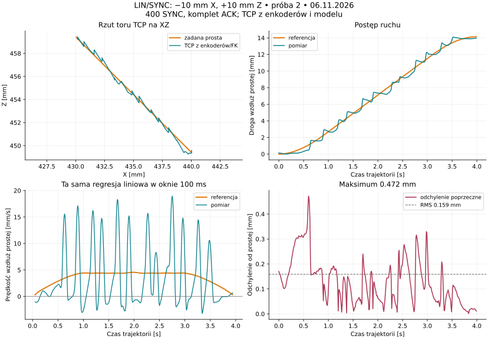
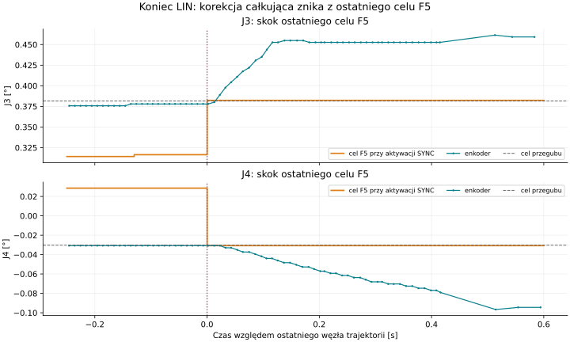

# Próba 2 — synchroniczny LIN TCP, 06.11.2026

**Stan: wykonana po zgodzie „Zatwierdzam próbę 2”; pełny LIN/SYNC zakończony
poprawnie.** Jedno załączenie i jedno wykonanie, bez powrotu i bez ponowienia.
Potwierdzono postój sześciu osi z podtrzymaniem ENABLE. Nadzór zastąpił
obserwator użyty w [przerwanej próbie 1](tcp_lin_physical_trial_2026-11-06.md).
Kod produkcyjny, PID, kalibracja i konfiguracja napędów nie były zmieniane;
usług nie restartowano.

## Wynik sprzętowy — 20:02:15 CET

Wykonano skoordynowany odcinek od pozycji ustalonej po ENABLE:
`[440,02830; 0,20250; 449,39791] → [430,02823; 0,20269; 459,39785] mm`.
Długość referencji 14,14214 mm, czas 3,99 s, obliczona maksymalna prędkość
4,57280 mm/s. Sterownik potwierdził końcowe pozycje i postój wszystkich osi,
po czym przywrócił tryb bez SYNC. Nie wystąpiło przerwanie przez obserwatora.

| Wielkość | Wynik |
| --- | --- |
| SYNC / F5 / ACK | 400 / 2400 / 2400; komplet przed każdą aktywacją |
| Okres SYNC, średnia / odchylenie standardowe | 9,999883 / 0,042949 ms |
| Najmniejszy / największy okres SYNC | 9,835540 / 10,168476 ms |
| Minimalny zapas ACK w zapisie pasywnym | 6,843 ms |
| Timeouty / błędne sumy / ramki błędu CAN / utrata odbiornika | 0 / 0 / 0 / 0 |
| Odchylenie TCP poprzecznie do prostej: średnia / RMS / p95 / maks. | **0,129 / 0,159 / 0,311 / 0,472 mm** |
| Błąd TCP względem punktu referencji w tym samym czasie: RMS / maks. | **0,385 / 0,941 mm** |
| Błąd wzdłuż prostej: najmniejszy / największy | −0,708 / +0,910 mm |
| Błąd orientacji, maks. | 0,175° |
| Końcowy błąd TCP po potwierdzeniu postoju | 0,455 mm |



### Płynność

Przy prawie stałej prędkości referencji pomiary enkoderów nadal pokazują
wyraźne pulsowanie. Po jednakowej regresji liniowej w oknie 100 ms, w obszarze
referencyjnej prędkości ≥90% jej maksimum:

- referencja: **4,399 ±0,070 mm/s**;
- pomiar: **4,469 ±6,258 mm/s**, zakres −3,020…18,950 mm/s;
- w 20 z 37 aktywnych okien 100 ms (54,1%) postęp TCP był mniejszy niż połowa
  postępu referencji. „Aktywne” oznacza referencyjny postęp co najmniej 0,1 mm.

To ocena prędkości wyliczonej z enkoderów/FK po opisanej filtracji, a nie
pomiar niezależnym czujnikiem TCP. Nie dowodzi osobno udziału tarcia,
regulatora napędu, przelicznika jednostek lub właściwości raportowania 31.
Regularny, kompletny strumień 100 Hz w tej próbie nie wyjaśnia obserwowanych
impulsów prędkości brakami F5/SYNC.

| Oś | Średni bezwzględny uchyb w ruchu [°] | Maks. uchyb w ruchu [°] | Końcowy uchyb po postoju [°] | Komendy F5 przy minimum 1 RPM* |
| --- | --- | --- | --- | --- |
| J1 | 0,00335 | 0,01318 | +0,02100 | 100% |
| J2 | 0,03263 | 0,10691 | −0,00723 | 56,75% |
| J3 | 0,01712 | 0,06336 | +0,07333 | 100% |
| J4 | 0,00925 | 0,04179 | −0,06201 | 100% |
| J5 | 0,02278 | 0,10685 | −0,03315 | 71,5% |
| J6 | 0,00167 | 0,00614 | +0,00709 | 100% |

\* RPM według przelicznika programu dla mikrokroku 128. J1/J4/J6 wykonują
bardzo małe ruchy kompensacyjne. Dla J2/J3/J5 odsetek aktywnych okien 100 ms
z postępem poniżej połowy referencji wyniósł odpowiednio 46,2% / 34,4% / 20,5%.
Aktywne okno osi wymaga co najmniej dwóch impulsów referencyjnej zmiany kąta.
J5 wykonał dodatni ruch w zadanym kierunku; w tej próbie nie odtworzono
wcześniejszej ciągłej jazdy przeciwnie do celu po F5.

### Konkretna przyczyna skoku na końcu

`streaming_motion.cpp:53–55` dodaje wypracowaną korekcję całkującą do celu
tylko przy `remaining_time_sec>0`. W ostatnim węźle warunek jest fałszywy.
Ostatnia komenda pomija zatem korekcję, mimo że poprzednia już z nią pracowała.
W dwóch ostatnich zestawach bazowy horyzont dochodzi do tego samego punktu
końcowego; nie jest to zamierzony kolejny krok trajektorii.

W zapisie cel J3 przeskoczył **144 → 174 impulsy**, czyli **+0,065918°**,
a J4 **13 → −14 impulsów**, czyli **−0,059326°**. Po ostatnim SYNC encoder J3,
wcześniej bliski pozycji zadanej, odsunął się od celu o około +0,073°;
J4 o około −0,062°. Końcowy błąd TCP wzrósł do 0,455 mm. To identyfikuje
politykę przejścia do końca jako źródło dodatkowego końcowego ruchu;
nie tłumaczy pulsowania obserwowanego wcześniej na całym odcinku.



Pierwsza proponowana poprawka: zatrzymać narastanie całki po zakończeniu
trajektorii, ale zachować już obliczoną korekcję w ostatnim F5 i przekazać ją
ciągle do fazy dolotu/postoju. Trzeba wspólnie uwzględnić wykonawców programu
i JOG TCP, limity i reset stanu nowej sesji. **Nie wdrożono tej poprawki**;
jej wpływ wymaga porównania na tym samym odcinku i osobnej zgody na ruch.

Drugi temat do weryfikacji: zachowanie przy bardzo małych prędkościach i dolne
ograniczenie komendy. J3 przez całą próbę otrzymywał minimum, chociaż jego
referencyjna prędkość jest znacznie mniejsza. Nie należy od razu utożsamiać
wartości z przelicznika programu z gwarantowaną prędkością fizyczną napędu.
Przed zmianą skalowania potrzebna jest osobna weryfikacja F5 względem
[instrukcji Makerbase V1.0.9, rozdziały 10 i 11.4](https://github.com/makerbase-motor/MKS-SERVO42D-57D/blob/master/User%20Manual/V1.0.9/MKS%20SERVO42%2657D_CAN%20User%20Manual%20V1.0.9.pdf)
i pomiarów; nie zmieniano jednostek ani parametrów podczas tej próby.

### Metoda i interpretacja diagnostyki

Analiza: 400 punktów co 10 ms, pozycje sześciu osi interpolowane do wspólnego
czasu wyłącznie pomiędzy pomiarami, bez ekstrapolacji. Największy użyty
przedział interpolacji 21,028 ms. Faza pochodzi z końcowego terminu SYNC
i indeksu 399; zgodność potwierdzono wszystkimi 400 aktywacjami.
Znaczniki CAN są programowymi timestampami jądra, nie pomiarem na przewodzie.

Przyrost `missed_cycles=465` **nie oznacza utraty 465 zestawów SYNC**.
`start_cycle()` zwiększa ten licznik także dla `active_ && !feedback_recorded_`,
a zapis `feedback_recorded_` w `tick()` pomija `Source::program`. To mieszana
metryka cykli i odczytów. Zapis surowy potwierdza komplet 400 terminów;
licznik wymaga osobnego rozdzielenia, nie jest dowodem przerw tej transmisji.

Po wykonaniu ponownie sprawdzono 15 snapshotów przez około 1,4 s:
świeże dane, brak ruchu i awarii, wszystkie ENABLE=1. Zmiana wskazań w tym
oknie nie przekraczała jednego impulsu przegubu (0,002197°).
Nie wykonano dodatkowego ruchu ani powrotu. Wynik jest bazą pomiarową;
nie jest deklaracją poprawy względem innego profilu lub wcześniejszej próby.

Artefakty: `log/tcp-lin-trial2-20261106/measurement_summary.json`,
`tcp_common_time.csv`, `can_capture.jsonl`, `executed_plan.json`,
`terminal_command_steps.json`, `stop_verification.json`, `analyze_measurement.py`.

## Zatwierdzona karta

Jedno załączenie J1–J6 i jeden skoordynowany LIN w trybie `synchronized`,
100 Hz. Bez automatycznego powtórzenia i bez ruchu powrotnego.

1. **Załączenie:** przygotować sześć osi, poczekać na ustalenie pozycji.
   Podczas tej fazy zakres względem pozycji sprzed ENABLE wynosi maksymalnie
   **0,5° na oś i 3 mm przesunięcia TCP**; przekroczenie powoduje STOP.
2. **Ruch:** od pozycji ustalonej po ENABLE przesunąć TCP w układzie bazowym
   **−10 mm X, 0 mm Y, +10 mm Z**, z zachowaniem orientacji. Cel i trajektoria
   zostaną obliczone ponownie od tych rzeczywistych pomiarów, przed `execute`.
3. **Profil:** długość około **14,14 mm**, limit przesuwu **5 mm/s**,
   przyspieszenia **10 mm/s²**, obrotu **2°/s**. Trajektoria maksymalnie **5 s**;
   całe wykonanie od żądania startu, z uzbrojeniem i dolotem, maksymalnie **10 s**.
4. **Koniec:** potwierdzony postój z podtrzymaniem ENABLE. W razie przerwania
   globalny STOP i istniejąca procedura wyłączenia/odzyskiwania.

Przewidywane kierunki głównych osi: **J2 ujemny, J3 dodatni, J5 dodatni**.
J1 utrzymuje położenie, J4/J6 kompensują orientację; dopuszczony zakres od
ustalonej pozycji startowej wynosi:

| Oś | Orientacyjna zmiana z podglądu | Maksymalny zakres próby od startu LIN |
| --- | --- | --- |
| J1 | +0,001° | ±0,1° |
| J2 | −2,256° | ±3°; STOP przy ruchu przeciwnym >0,1° |
| J3 | +0,309° | ±3°; STOP przy ruchu przeciwnym >0,1° |
| J4 | +0,036° | ±0,5° |
| J5 | +1,947° | ±3°; STOP przy ruchu przeciwnym >0,1° |
| J6 | −0,036° | ±0,5° |

Obliczony plan musi zachować zapas: maksymalnie 2,5° J2/J3/J5,
0,25° J4/J6 i 0,05° J1. Sprawdzane są wszystkie interpolowane przedziały
co 2 ms, limity mechaniczne oraz sześć faktycznie uczestniczących osi.
Odmienne rozwiązanie IK kończy przygotowanie; procedura nie ponawia go ruchem.

## Warunki STOP

- Odchylenie poprzeczne TCP od przygotowanej prostej **>3 mm** lub rzut poza
  odcinek rozszerzony o **1 mm** z każdej strony.
- Przekroczenie zakresów osi, mechanicznych limitów lub ruch głównej osi
  przeciwnie do karty o więcej niż 0,1°.
- Wiek surowej pozycji CAN **≥250 ms podczas uzbrajania przed pierwszym SYNC**
  albo **≥150 ms po pierwszym SYNC**. Przed uzbrajaniem limit wynosi 150 ms.
- Błąd CAN, nieprawidłowa suma kontrolna, utrata danych odbiornika, brak
  aktualnych metadanych ROS, zmiana konfiguracji, utrata kalibracji lub awaria.
- Przekroczenie terminu wykonania 10 s lub przygotowania/nadzoru 90 s.

Nadzór jest sprawdzany nominalnie co 25 ms. Progi oznaczają zlecenie STOP;
pozostaje czas transmisji i hamowania. Operator musi mieć możliwość
zatrzymania awaryjnego. Istniejące zabezpieczenia C++ pozostają aktywne.

## Co zmieniono w przygotowaniu

Pozycje pochodzą z pasywnie odbieranych ramek 31, ze znacznikami czasu jądra.
Wiek uwzględnia czas oczekiwania ramki w odbiorniku. Sześć osi jest
interpolowanych do wspólnego czasu bez ekstrapolacji; FK korzysta z modelu
i przeliczników bieżącej konfiguracji. Snapshot ROS/HTTP służy do odczytu
kalibracji, rewizji i awarii, a nie do określania wieku pozycji CAN.

Osobna obwiednia dla ENABLE usuwa błędne traktowanie krótkiego ustalania
napędu jako wyjścia poza początek przyszłego odcinka LIN. Dopiero po ustaleniu
ENABLE wyznaczane są start, orientacja i nowy cel względny. Nie dopasowujemy
przypadkowo przesuniętego startu do dawnego absolutnego celu.

Procedura wykonuje jedno żądanie ENABLE i jedno `execute`; każde odrzucenie
kończy próbę, bez automatycznej zmiany progów i ponowienia. Po przygotowaniu
programu wymagana jest zgodność LIN/SYNC, `tcp_verified=true` i sześć osi.

## Sprawdzenia przed ruchem

- Pełne odtworzenie poprzedniego zapisu, **łącznie z ENABLE**: 372 oceny co
  10 ms, bez nieoczekiwanego STOP. Największe przesunięcie TCP podczas
  załączania 1,33710 mm; wiek pozycji podczas uzbrajania do 164,057 ms.
- Wstrzyknięte błędy: STOP przy wieku 151 ms w ruchu i 251 ms w uzbrajaniu,
  przesunięciu TCP 4 mm i osi 0,6° podczas ENABLE, odchyleniu TCP z surowych
  ramek oraz przeciwnym ruchu J2. Wynik `replay_result.json`.
- Pasywne sprawdzenie zintegrowanego odbiornika: 589 ramek, 39 ocen,
  bez błędu i bez nadawania komend. `passive_guard_check.json`.
- Aktualna kontrola: sześć dostępnych, skalibrowanych osi; ENABLE=0,
  brak aktywnego ruchu i awarii, rejestracja aktywna bez zgubionych próbek.
- Wstępny podgląd od pomiarów przed ENABLE: 3,73 s, szczyt 4,86510 mm/s.
  Sprawdzenie co 1 ms (3731 próbek): maksymalna odchyłka prostej 0,002010 mm,
  zmiana orientacji 0,000884°. To wyniki obliczeń, nie pomiar jazdy.

TCP z enkoderów i FK nie obejmuje ugięć ani luzów za enkoderami. Po wykonaniu
ocenimy odchyłkę poprzeczną i wzdłużną, prędkość i postoje w oknach
100 ms, orientację, uchyby osi i terminy F5/SYNC. Samo zaliczenie replay nie
potwierdza fizycznej płynności ani poprawności śledzenia J5.

## Artefakty i uruchomienie

Katalog: `log/tcp-lin-trial2-20261106/`. Zawiera wstępny plan, model,
konfigurację, obliczenia, wyniki sprawdzeń, manifest progów oraz kompletny
skrypt jednej próby. Katalog `log/` jest pomijany przez Git.

```bash
# Tylko odczyty, bez ruchu:
python3 log/tcp-lin-trial2-20261106/run_once.py

# Wyłącznie po zgodzie operatora na tę kartę:
python3 -u log/tcp-lin-trial2-20261106/run_once.py --execute-approved-once
```

Uruchomienie nie wymaga kompilacji pakietów ROS ani restartu usługi.
Procedura nie zmienia PID, prądu, mikrokroku ani kalibracji. Potwierdzenie
resetu zasilania J5 z poprzedniej rozmowy pozostaje uwzględnione.
